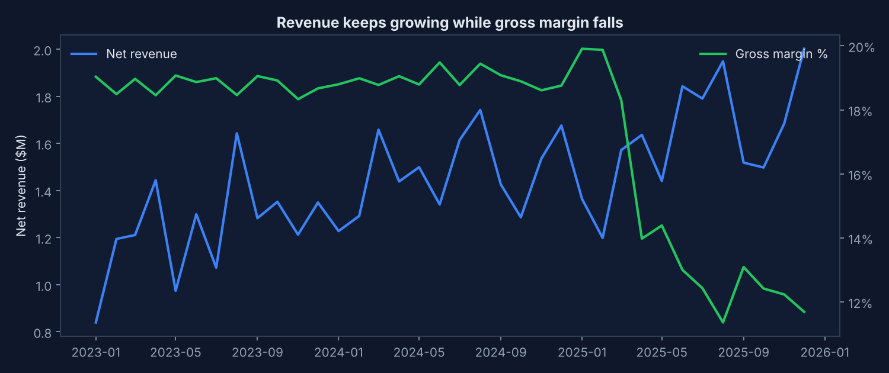
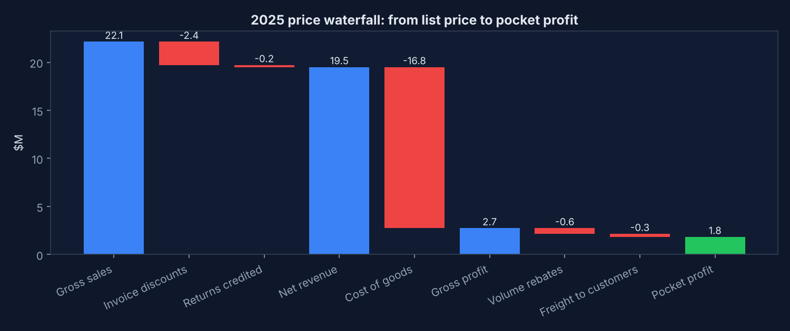
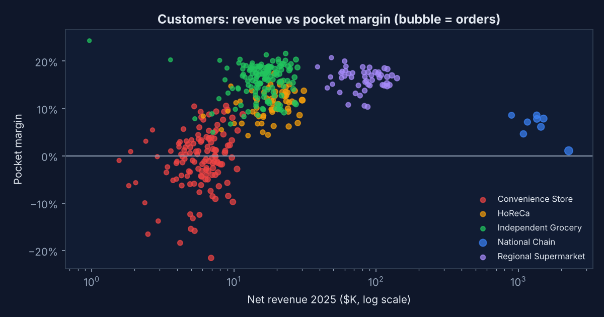
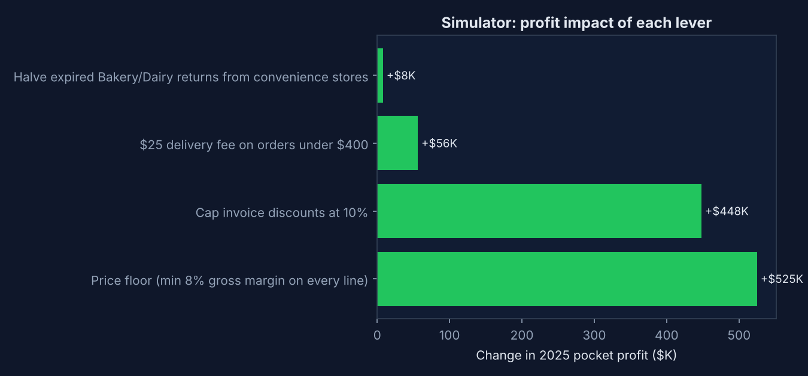
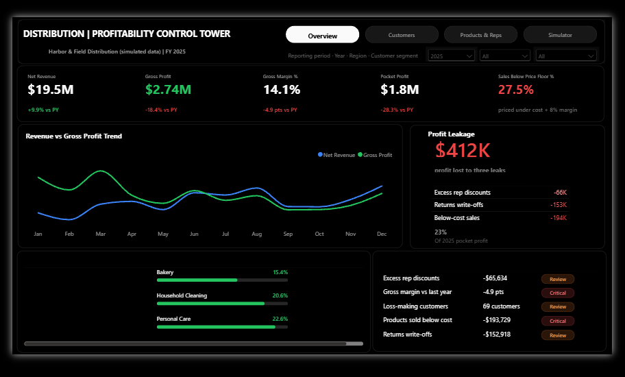
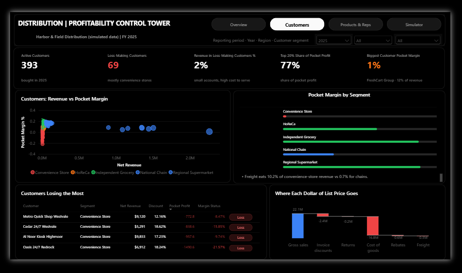
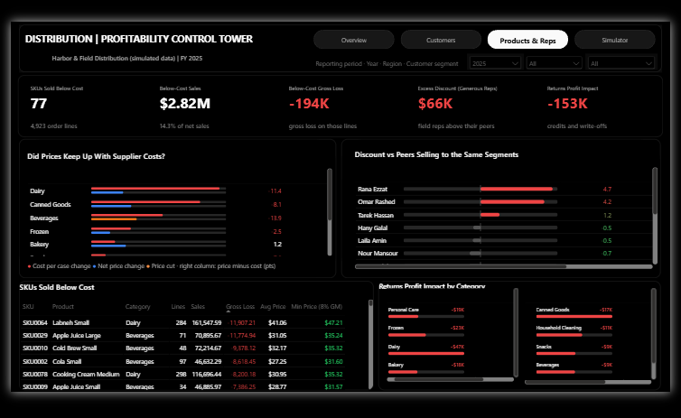
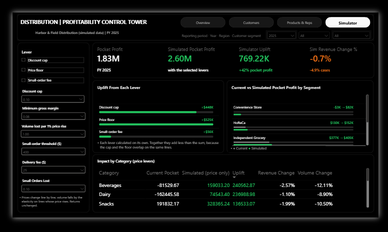
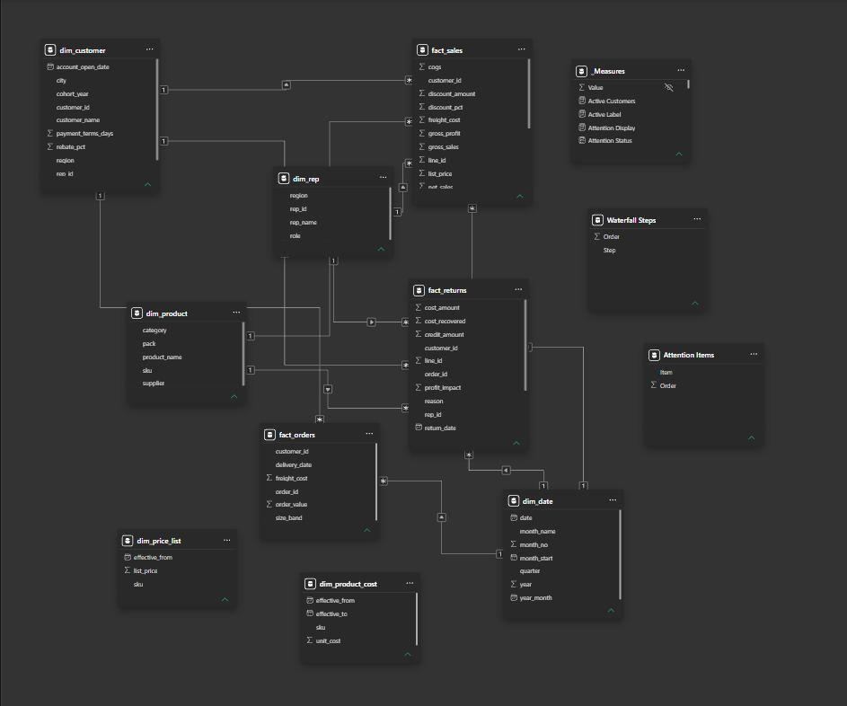

# Profit Leak Detective: B2B Distribution Profitability Control Tower

**Revenue grew 31% in two years. Pocket profit fell 28% in the last one. This project finds where the money went and what to change.**

`Python` · `SQL (PostgreSQL)` · `Power BI` · `DAX` · **Simulated data**

> **About the data:** Harbor & Field Distribution is a fictional B2B food and household-goods wholesaler. The dataset is simulated (`python/01_generate_raw_data.py`): 400 retail and food-service customers, 180 SKUs, 14 sales reps, 126,864 order lines from Jan 2023 to Dec 2025. It was built to behave like real ERP exports, including supplier cost increases, rep-level discounting, chain rebates, freight on small drops, short-life returns and 22 kinds of data-quality problems. Every number below is produced by the code in this repository.

---

## The business problem

Management sees sales going up every year and assumes the business is doing well. Finance sees margin shrinking but can't say why. The dashboard answers five questions:

1. Are we becoming more profitable, or just selling more?
2. Which products and customers make or destroy profit?
3. Are sales reps giving away margin through discounts?
4. Which products are sold below their minimum profitable price?
5. What happens to profit if we change prices, discounts or delivery terms?

The key measure is **pocket profit**: what is left after invoice discounts, returns, cost of goods, volume rebates and freight. A customer can look healthy on gross margin and still lose money once rebates and delivery are paid.



## What I found (2025)

| | |
|---|---|
| **Selling more, earning less** | Net revenue $14.87M → $19.50M (+31% since 2023). Gross profit fell 18% in 2025 to $2.74M; gross margin 18.7% → 14.1%. Pocket profit fell 28% to $1.83M. |
| **Costs rose, prices didn't** | Beverages: cost per case +8.5%, net price per case −5.4% (a chain promotion on top of a supplier increase), margin −12.6 pts. Dairy: cost +15.2%, price +3.8%, margin −9.8 pts. |
| **Selling below cost** | 4,923 order lines across 77 SKUs were invoiced below unit cost: $2.82M of sales and $194K of gross loss, 90% of it with national chains. |
| **The biggest customer barely pays** | FreshCart Group is 12% of revenue ($2.26M) but earns a 1.1% pocket margin after a 16.4% average discount and $159K of rebates. |
| **Small drops lose money** | 69 of 130 convenience stores are loss-making. Freight is 10.2% of their revenue (0.7% for chains) and short-life returns run at 3.6% of sales. |
| **Two reps discount far above peers** | Compared with reps selling to the same segments, two reps give 4.7 and 4.2 extra points of discount ($58K in 2025). Higher discounts are not linked to bigger customers (correlation −0.28 to −0.07 by segment). |





## What to do about it

| Lever (simulated on 2025 data) | Pocket profit uplift |
|---|---|
| Price floor: every line keeps at least 8% gross margin | +$525K |
| Cap invoice discounts at 10% | +$448K |
| $25 delivery fee on orders under $400 | +$56K |
| Cap + floor + fee together | **+$769K (+42%)**, for −0.7% revenue and −4.9% volume |

Assumptions: each 1% price rise loses 1% volume on the affected line (a cautious elasticity), and 10% of small orders are lost after the fee. All six inputs are sliders on the simulator page.



## The dashboard

Four pages built in Power BI (star schema, DAX measures, SVG progress bars and status pills, what-if parameters). The full build guide, with every measure and visual position, is in [`docs/POWER_BI_BUILD_GUIDE_BLACK.md`](docs/POWER_BI_BUILD_GUIDE_BLACK.md).

**1. Overview**: KPIs vs last year, revenue vs gross profit trend, $412K profit leakage split by source, pocket margin by category, management attention list.


**2. Customers**: revenue vs pocket margin for every customer, margin by segment, the customers losing the most, and where each dollar of list price goes.


**3. Products & Reps**: did prices keep up with supplier costs, rep discounting vs peers, SKUs sold below cost, returns by category.


**4. Simulator**: switch levers on and off and move the sliders (discount cap, minimum margin, elasticity, small-order fee) to see the effect on pocket profit, revenue and volume.


**Data model**


## Data cleaning

The raw files contain the problems real ERP exports have. Each fix is logged with its row count in [`data/clean/data_quality_log.csv`](data/clean/data_quality_log.csv). The most important ones:

- **540 returns keyed twice**, once as negative sales lines and once in the returns file. Kept only the returns file, so returns are not double counted.
- **761 duplicate lines** from a double export, and **540 lines** booked to 6 duplicate customer records, merged into the master IDs.
- **5,074 discounts typed as whole numbers** (8 instead of 0.08), which would have turned those lines into negative revenue.
- **10,149 dates in DD/MM/YYYY** from a second system, parsed explicitly instead of guessed.
- **185 orders with no freight cost**, imputed with the median for the same region and order size.
- Every clean line reconciles to the raw file: 128,225 raw lines − 60 test − 761 duplicates − 540 negative = 126,864 clean lines.

## Repository

```
data/raw/          8 messy ERP exports (CSV)
data/clean/        star schema: 6 dimensions, 3 facts + data_quality_log.csv
python/            01 generate · 02 clean · 03 analyse · 04 wireframes · 05 mockups
sql/               01 schema · 02 load · 03 views · 04 analysis queries (one per question)
outputs/           findings.md, result tables, charts
powerbi/           black theme JSON (+ the earlier navy theme)
docs/              dashboard screenshots, Power BI build guides, mockups and wireframes
```

## How to run

```bash
pip install -r requirements.txt
cd python
python 01_generate_raw_data.py   # optional: the raw data is already included
python 02_clean_data.py
python 03_analysis.py
```

For SQL: create a PostgreSQL database, then from the project folder run `psql -d yourdb -f sql/01_create_schema.sql`, `-f sql/02_load_data.sql`, `-f sql/03_views.sql`, and the queries in `sql/04_analysis_queries.sql`. The Python, SQL and Power BI numbers reconcile to the dollar.
