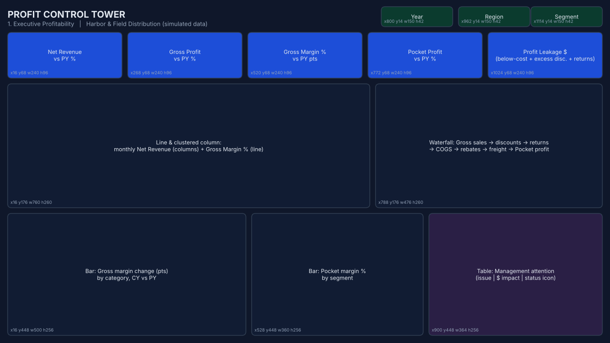
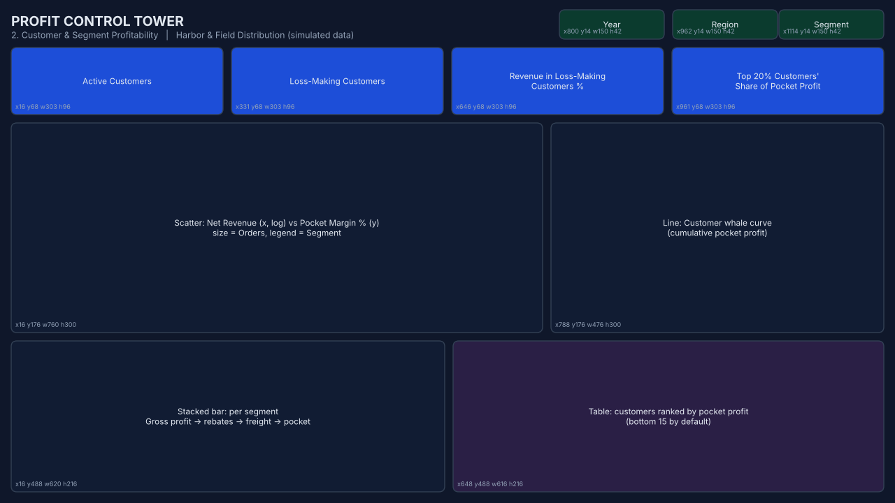
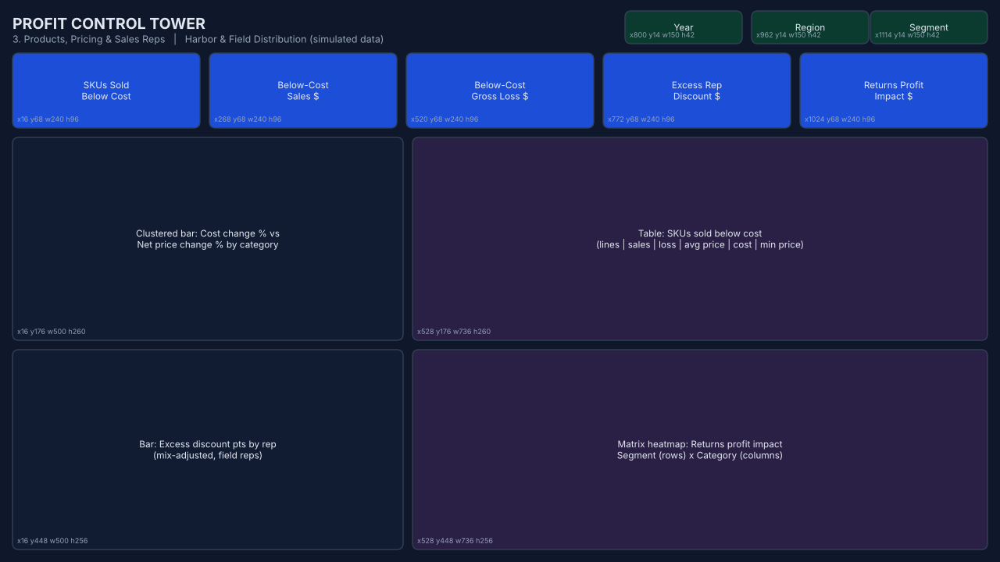
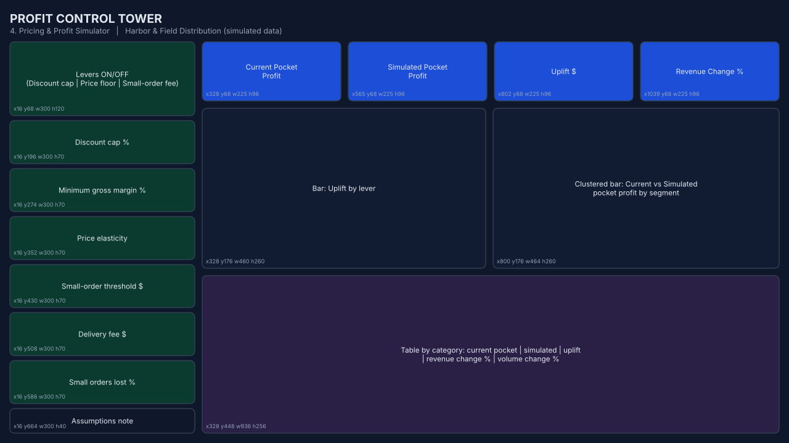

# Power BI Build Guide: Profit Leak Detective

Four pages, built on the clean star schema in `data/clean/`. Follow the steps in order. Each visual has a size and position for a **1280 x 720** canvas: set them in *Format > General > Properties*. The wireframes in `docs/wireframes/` show the same layout.

| Page | Question it answers |
|---|---|
| 1. Executive Profitability | Are we more profitable, or just selling more? |
| 2. Customer & Segment Profitability | Which customers and segments make or destroy profit? |
| 3. Products, Pricing & Sales Reps | What is sold below cost, and who is giving margin away? |
| 4. Pricing & Profit Simulator | What happens to profit if we change prices, discounts or delivery terms? |

---

## Step 1. Load the data

1. **Get Data > Text/CSV** and load these 9 files from `data/clean/`:
   `dim_date`, `dim_customer`, `dim_product`, `dim_rep`, `dim_product_cost`, `dim_price_list`, `fact_sales`, `fact_returns`, `fact_orders`.
   (Do not load `data_quality_log.csv` into the model. Use it in the README and on a notes page if you add one.)
2. In **Power Query**, check the types:
   - Every `*_date`, `date`, `month_start`, `effective_from`, `effective_to` column: **Date**.
   - Money columns (`gross_sales`, `net_sales`, `cogs`, `unit_cost`, `list_price`, `rebate_amount`, `freight_cost`, `gross_profit`, `pocket_profit`, `credit_amount`, `cost_amount`, `cost_recovered`, `write_off_cost`, `profit_impact`, `order_value`): **Fixed decimal number**.
   - `discount_pct`, `rebate_pct`: **Decimal number**.
   - `quantity`, `return_qty`, `line_id`, `year`, `month_no`: **Whole number**.
3. **Close & Apply**.
4. Select `dim_date` > **Table tools > Mark as date table** > choose `date`.
5. In `dim_date`, set `month_name` to **Sort by column** `month_no`.

## Step 2. Relationships (Model view)

All relationships are **one-to-many, single direction**, from the dimension to the fact.

| From (one side) | To (many side) | Active |
|---|---|---|
| `dim_date[date]` | `fact_sales[order_date]` | Yes |
| `dim_date[date]` | `fact_returns[sale_date]` | Yes |
| `dim_date[date]` | `fact_orders[delivery_date]` | Yes |
| `dim_customer[customer_id]` | `fact_sales[customer_id]` | Yes |
| `dim_customer[customer_id]` | `fact_returns[customer_id]` | Yes |
| `dim_customer[customer_id]` | `fact_orders[customer_id]` | Yes |
| `dim_product[sku]` | `fact_sales[sku]` | Yes |
| `dim_product[sku]` | `fact_returns[sku]` | Yes |
| `dim_rep[rep_id]` | `fact_sales[rep_id]` | Yes |
| `dim_rep[rep_id]` | `fact_returns[rep_id]` | Yes |

Leave `dim_product_cost` and `dim_price_list` unrelated. They are reference tables for drill-through and tooltips.

> **Why `sale_date` for returns:** a return is counted in the year the goods were sold, so a December sale returned in January lowers that December's profit. The Python and SQL use the same rule, so the totals match.

Hide all ID and key columns in the fact tables (right-click > *Hide in report view*). The report should only show dimension columns and measures.

## Step 3. Helper tables

> ⚠️ **Create every table in this step with Modeling > New table, not New measure.** If you paste a `DATATABLE` into a new measure, Power BI shows *"The expression refers to multiple columns. Multiple columns cannot be converted to a scalar value."* Delete that measure and create it again as a table.

**Home > Enter data** is fine for small tables, but DAX tables are easier to rebuild. Use **Modeling > New table** for each one.

```dax
_Measures = { BLANK() }
```
(Create every measure in this table, then hide its one column. It becomes a measure folder.)

```dax
Waterfall Steps =
DATATABLE (
    "Step", STRING, "Order", INTEGER,
    {
        { "Gross sales", 1 }, { "Invoice discounts", 2 }, { "Returns", 3 },
        { "Cost of goods", 4 }, { "Rebates", 5 }, { "Freight", 6 }
    }
)
```

```dax
Attention Items =
DATATABLE (
    "Item", STRING, "Order", INTEGER,
    {
        { "Products sold below cost", 1 },
        { "Excess rep discounts", 2 },
        { "Returns write-offs", 3 },
        { "Loss-making customers", 4 },
        { "Gross margin vs last year", 5 }
    }
)
```

```dax
Levers = DATATABLE ( "Lever", STRING, { { "Discount cap" }, { "Price floor" }, { "Small-order fee" } } )
Lever Chart = DATATABLE ( "Lever", STRING, "Order", INTEGER, { { "Discount cap", 1 }, { "Price floor", 2 }, { "Small-order fee", 3 } } )
```

Set `Step` sorted by `Order`, `Item` sorted by `Order`, and `Lever Chart[Lever]` sorted by `Order`.

### What-if parameters (page 4)

**Modeling > New parameter > Numeric range**. Untick *Add slicer to this page* (you'll add them on page 4 later). Power BI creates the table and a `... Value` measure for each one.

| Name | Data type | Min | Max | Increment | Default |
|---|---|---|---|---|---|
| Discount Cap | Decimal | 0.05 | 0.30 | 0.01 | 0.10 |
| Min Gross Margin | Decimal | 0.00 | 0.20 | 0.01 | 0.08 |
| Elasticity | Decimal | 0.0 | 2.0 | 0.1 | 1.0 |
| Small Order Threshold | Whole | 100 | 1000 | 50 | 400 |
| Delivery Fee | Whole | 0 | 60 | 5 | 25 |
| Small Orders Lost | Decimal | 0.00 | 0.50 | 0.05 | 0.10 |

> **If a `... Value` measure is missing** (error: *"The value for 'Discount Cap Value' cannot be determined"*), the parameter wasn't created or has a different name. Check the Data pane: each parameter must appear as a table (e.g. `Discount Cap`) containing a column and a measure named exactly `Discount Cap Value`. You can also create all six by hand. Make each table with **Modeling > New table**, then each measure with **New measure** in that table:
>
> ```dax
> Discount Cap = GENERATESERIES ( 0.05, 0.30, 0.01 )
> Discount Cap Value = SELECTEDVALUE ( 'Discount Cap'[Value], 0.10 )
>
> Min Gross Margin = GENERATESERIES ( 0, 0.20, 0.01 )
> Min Gross Margin Value = SELECTEDVALUE ( 'Min Gross Margin'[Value], 0.08 )
>
> Elasticity = GENERATESERIES ( 0, 2, 0.1 )
> Elasticity Value = SELECTEDVALUE ( 'Elasticity'[Value], 1 )
>
> Small Order Threshold = GENERATESERIES ( 100, 1000, 50 )
> Small Order Threshold Value = SELECTEDVALUE ( 'Small Order Threshold'[Value], 400 )
>
> Delivery Fee = GENERATESERIES ( 0, 60, 5 )
> Delivery Fee Value = SELECTEDVALUE ( 'Delivery Fee'[Value], 25 )
>
> Small Orders Lost = GENERATESERIES ( 0, 0.50, 0.05 )
> Small Orders Lost Value = SELECTEDVALUE ( 'Small Orders Lost'[Value], 0.10 )
> ```
>
> On page 4, use the `[Value]` column of each table in a slider slicer (*Slicer settings > Style: Single value* for the parameter look).

## Step 4. Measures

Create these in `_Measures`. Put them in display folders (*Properties > Display folder*) as labelled. Format: money as **Currency, 0 decimals**; ratios as **Percentage, 1 decimal**.

### Folder: 1 Base

```dax
Gross Sales = SUM ( fact_sales[gross_sales] )
Discounts = SUM ( fact_sales[discount_amount] )
Net Sales = SUM ( fact_sales[net_sales] )
Return Credit = SUM ( fact_returns[credit_amount] )
Net Revenue = [Net Sales] - [Return Credit]
COGS = SUM ( fact_sales[cogs] ) - SUM ( fact_returns[cost_recovered] )
Gross Profit = [Net Revenue] - [COGS]
Gross Margin % = DIVIDE ( [Gross Profit], [Net Revenue] )
Rebates = SUM ( fact_sales[rebate_amount] )
Freight = SUM ( fact_sales[freight_cost] )
Pocket Profit = [Gross Profit] - [Rebates] - [Freight]
Pocket Margin % = DIVIDE ( [Pocket Profit], [Net Revenue] )
Discount % = DIVIDE ( [Discounts], [Gross Sales] )
Cases = SUM ( fact_sales[quantity] )
Orders = DISTINCTCOUNT ( fact_sales[order_id] )
Avg Order Value = DIVIDE ( [Net Sales], [Orders] )
Active Customers = DISTINCTCOUNT ( fact_sales[customer_id] )
Freight % of Revenue = DIVIDE ( [Freight], [Net Revenue] )
Return Rate % = DIVIDE ( [Return Credit], [Net Sales] )
```

### Folder: 2 Time comparison

```dax
Net Revenue PY = CALCULATE ( [Net Revenue], SAMEPERIODLASTYEAR ( dim_date[date] ) )
Net Revenue YoY % = DIVIDE ( [Net Revenue] - [Net Revenue PY], [Net Revenue PY] )
Gross Profit PY = CALCULATE ( [Gross Profit], SAMEPERIODLASTYEAR ( dim_date[date] ) )
Gross Profit YoY % = DIVIDE ( [Gross Profit] - [Gross Profit PY], [Gross Profit PY] )
Pocket Profit PY = CALCULATE ( [Pocket Profit], SAMEPERIODLASTYEAR ( dim_date[date] ) )
Pocket Profit YoY % = DIVIDE ( [Pocket Profit] - [Pocket Profit PY], [Pocket Profit PY] )
Gross Margin PY % = CALCULATE ( [Gross Margin %], SAMEPERIODLASTYEAR ( dim_date[date] ) )
Gross Margin Change pts = ( [Gross Margin %] - [Gross Margin PY %] ) * 100

-- invoice-level margin per case (before returns), used for the cost pass-through chart
Net Price per Case = DIVIDE ( [Net Sales], [Cases] )
Cost per Case = DIVIDE ( SUM ( fact_sales[cogs] ), [Cases] )
Net Price Change % = DIVIDE ( [Net Price per Case], CALCULATE ( [Net Price per Case], SAMEPERIODLASTYEAR ( dim_date[date] ) ) ) - 1
Cost Change % = DIVIDE ( [Cost per Case], CALCULATE ( [Cost per Case], SAMEPERIODLASTYEAR ( dim_date[date] ) ) ) - 1
Invoice Margin % = 1 - DIVIDE ( SUM ( fact_sales[cogs] ), [Net Sales] )
Invoice Margin Change pts =
    ( [Invoice Margin %] - CALCULATE ( [Invoice Margin %], SAMEPERIODLASTYEAR ( dim_date[date] ) ) ) * 100
```

### Folder: 3 Profit leaks

```dax
Below-Cost Sales =
SUMX (
    FILTER ( fact_sales, fact_sales[net_sales] < fact_sales[unit_cost] * fact_sales[quantity] ),
    fact_sales[net_sales]
)

Below-Cost Gross Loss =
SUMX (
    FILTER ( fact_sales, fact_sales[net_sales] < fact_sales[unit_cost] * fact_sales[quantity] ),
    fact_sales[net_sales] - fact_sales[unit_cost] * fact_sales[quantity]
)

Below-Cost Lines =
COUNTROWS ( FILTER ( fact_sales, fact_sales[net_sales] < fact_sales[unit_cost] * fact_sales[quantity] ) )

SKUs Sold Below Cost =
CALCULATE (
    DISTINCTCOUNT ( fact_sales[sku] ),
    FILTER ( fact_sales, fact_sales[net_sales] < fact_sales[unit_cost] * fact_sales[quantity] )
)

Min Price (8% GM) = DIVIDE ( AVERAGE ( fact_sales[unit_cost] ), 1 - 0.08 )
Avg Net Price = DIVIDE ( [Net Sales], [Cases] )

-- discount rate of field reps selling to the same segment (the "peer" rate)
Segment Discount Rate (Field) =
CALCULATE (
    [Discount %],
    REMOVEFILTERS ( dim_rep ),
    dim_rep[role] = "Field Sales Rep",
    REMOVEFILTERS ( dim_customer ),
    VALUES ( dim_customer[segment] )
)

Expected Discount =
SUMX ( VALUES ( dim_customer[segment] ), [Gross Sales] * [Segment Discount Rate (Field)] )

Excess Discount $ =
CALCULATE ( [Discounts] - [Expected Discount], KEEPFILTERS ( dim_rep[role] = "Field Sales Rep" ) )

Excess Discount pts = DIVIDE ( [Excess Discount $], [Gross Sales] ) * 100

-- only the reps above their peers count as leakage
Excess Discount (Generous Reps) =
SUMX ( VALUES ( dim_rep[rep_id] ), MAX ( 0, [Excess Discount $] ) )

Returns Profit Impact = SUM ( fact_returns[profit_impact] )
Return Write-offs = SUM ( fact_returns[write_off_cost] )

Profit Leakage =
ABS ( [Below-Cost Gross Loss] ) + [Excess Discount (Generous Reps)] + ABS ( [Returns Profit Impact] )
```

### Folder: 4 Customers

```dax
Loss-Making Customers =
COUNTROWS ( FILTER ( VALUES ( dim_customer[customer_id] ), [Pocket Profit] < 0 ) )

Revenue in Loss-Making Customers % =
DIVIDE (
    SUMX ( FILTER ( VALUES ( dim_customer[customer_id] ), [Pocket Profit] < 0 ), [Net Revenue] ),
    [Net Revenue]
)

Top 20% Share of Pocket Profit =
VAR Cust =
    FILTER (
        ADDCOLUMNS ( VALUES ( dim_customer[customer_id] ), "@p", [Pocket Profit] ),
        NOT ISBLANK ( [@p] )
    )
VAR TopCust = TOPN ( ROUNDDOWN ( COUNTROWS ( Cust ) * 0.2, 0 ), Cust, [@p], DESC )
RETURN DIVIDE ( SUMX ( TopCust, [@p] ), SUMX ( Cust, [@p] ) )

Cumulative Profit Share =
VAR Cur = [Pocket Profit]
VAR Cust =
    FILTER (
        ADDCOLUMNS ( ALLSELECTED ( dim_customer[customer_name] ), "@p", [Pocket Profit] ),
        NOT ISBLANK ( [@p] )
    )
RETURN
    IF ( NOT ISBLANK ( Cur ), DIVIDE ( SUMX ( FILTER ( Cust, [@p] >= Cur ), [@p] ), SUMX ( Cust, [@p] ) ) )
```

### Folder: 5 Visual helpers

```dax
Waterfall Value =
SWITCH (
    SELECTEDVALUE ( 'Waterfall Steps'[Step] ),
    "Gross sales", [Gross Sales],
    "Invoice discounts", - [Discounts],
    "Returns", - [Return Credit],
    "Cost of goods", - [COGS],
    "Rebates", - [Rebates],
    "Freight", - [Freight]
)

Attention Value =
SWITCH (
    SELECTEDVALUE ( 'Attention Items'[Item] ),
    "Products sold below cost", [Below-Cost Gross Loss],
    "Excess rep discounts", - [Excess Discount (Generous Reps)],
    "Returns write-offs", [Returns Profit Impact],
    "Loss-making customers", [Loss-Making Customers],
    "Gross margin vs last year", [Gross Margin Change pts]
)

Attention Display =
VAR v = [Attention Value]
RETURN
SWITCH (
    SELECTEDVALUE ( 'Attention Items'[Item] ),
    "Loss-making customers", FORMAT ( v, "#,0" ) & " customers",
    "Gross margin vs last year", FORMAT ( v, "+0.0;-0.0" ) & " pts",
    FORMAT ( v, "$#,0;-$#,0" )
)

Attention Status =
VAR _item = SELECTEDVALUE ( 'Attention Items'[Item] )
VAR v = [Attention Value]
RETURN
SWITCH (
    TRUE (),
    _item = "Gross margin vs last year" && v <= -2, "Critical",
    _item = "Gross margin vs last year" && v < 0, "Review",
    _item = "Loss-making customers" && v >= 25, "Critical",
    _item = "Loss-making customers" && v > 0, "Review",
    _item IN { "Products sold below cost", "Excess rep discounts", "Returns write-offs" } && v <= -100000, "Critical",
    _item IN { "Products sold below cost", "Excess rep discounts", "Returns write-offs" } && v < 0, "Review",
    "OK"
)

Attention Status Color =
SWITCH ( [Attention Status], "Critical", "#EF4444", "Review", "#F59E0B", "#22C55E" )

Margin Color = IF ( [Pocket Margin %] < 0, "#EF4444", IF ( [Pocket Margin %] < 0.08, "#F59E0B", "#22C55E" ) )
Change Color = IF ( [Invoice Margin Change pts] < 0, "#EF4444", "#22C55E" )
Rep Color = IF ( [Excess Discount pts] > 1, "#EF4444", "#3B82F6" )

Report Subtitle =
"Harbor & Field Distribution (simulated data)  |  " &
IF ( HASONEVALUE ( dim_date[year] ), "FY " & VALUES ( dim_date[year] ), "FY 2023-2025" )
```

### Folder: 6 Simulator

The simulator changes prices line by line, so a price rise on one line only loses volume on that line. Returns are left unchanged.

```dax
Sim Pocket (Price Levers) =
VAR CapOn = "Discount cap" IN VALUES ( Levers[Lever] )
VAR FloorOn = "Price floor" IN VALUES ( Levers[Lever] )
VAR Cap = [Discount Cap Value]
VAR MinGM = [Min Gross Margin Value]
VAR E = [Elasticity Value]
RETURN
SUMX (
    fact_sales,
    VAR Qty = fact_sales[quantity]
    VAR NetPrice = DIVIDE ( fact_sales[net_sales], Qty )
    VAR P1 = IF ( CapOn, MAX ( NetPrice, fact_sales[list_price] * ( 1 - Cap ) ), NetPrice )
    VAR P2 = IF ( FloorOn, MAX ( P1, DIVIDE ( fact_sales[unit_cost], 1 - MinGM ) ), P1 )
    VAR Keep = MAX ( 0, 1 - E * ( DIVIDE ( P2, NetPrice ) - 1 ) )
    VAR NewQty = Qty * Keep
    VAR RebRate = DIVIDE ( fact_sales[rebate_amount], fact_sales[net_sales] )
    RETURN P2 * NewQty * ( 1 - RebRate ) - fact_sales[unit_cost] * NewQty - fact_sales[freight_cost] * Keep
)

Sim Net Sales =
VAR CapOn = "Discount cap" IN VALUES ( Levers[Lever] )
VAR FloorOn = "Price floor" IN VALUES ( Levers[Lever] )
VAR Cap = [Discount Cap Value]
VAR MinGM = [Min Gross Margin Value]
VAR E = [Elasticity Value]
RETURN
SUMX (
    fact_sales,
    VAR Qty = fact_sales[quantity]
    VAR NetPrice = DIVIDE ( fact_sales[net_sales], Qty )
    VAR P1 = IF ( CapOn, MAX ( NetPrice, fact_sales[list_price] * ( 1 - Cap ) ), NetPrice )
    VAR P2 = IF ( FloorOn, MAX ( P1, DIVIDE ( fact_sales[unit_cost], 1 - MinGM ) ), P1 )
    VAR Keep = MAX ( 0, 1 - E * ( DIVIDE ( P2, NetPrice ) - 1 ) )
    RETURN P2 * Qty * Keep
)

Sim Cases =
VAR CapOn = "Discount cap" IN VALUES ( Levers[Lever] )
VAR FloorOn = "Price floor" IN VALUES ( Levers[Lever] )
VAR Cap = [Discount Cap Value]
VAR MinGM = [Min Gross Margin Value]
VAR E = [Elasticity Value]
RETURN
SUMX (
    fact_sales,
    VAR NetPrice = DIVIDE ( fact_sales[net_sales], fact_sales[quantity] )
    VAR P1 = IF ( CapOn, MAX ( NetPrice, fact_sales[list_price] * ( 1 - Cap ) ), NetPrice )
    VAR P2 = IF ( FloorOn, MAX ( P1, DIVIDE ( fact_sales[unit_cost], 1 - MinGM ) ), P1 )
    RETURN fact_sales[quantity] * MAX ( 0, 1 - E * ( DIVIDE ( P2, NetPrice ) - 1 ) )
)

Price Lever Uplift = [Sim Pocket (Price Levers)] - SUM ( fact_sales[pocket_profit] )

Small Order Fee Effect (always on) =
VAR Thr = [Small Order Threshold Value]
VAR Fee = [Delivery Fee Value]
VAR Lost = [Small Orders Lost Value]
VAR OrdersT =
    ADDCOLUMNS (
        VALUES ( fact_sales[order_id] ),
        "@net", CALCULATE ( SUM ( fact_sales[net_sales] ) ),
        "@pocket", CALCULATE ( SUM ( fact_sales[pocket_profit] ) )
    )
VAR SmallT = FILTER ( OrdersT, [@net] < Thr )
RETURN COUNTROWS ( SmallT ) * ( 1 - Lost ) * Fee - SUMX ( SmallT, [@pocket] ) * Lost

Sim Fee Effect =
IF ( "Small-order fee" IN VALUES ( Levers[Lever] ), [Small Order Fee Effect (always on)], 0 )

Simulated Pocket Profit = [Pocket Profit] + [Price Lever Uplift] + [Sim Fee Effect]
Simulator Uplift = [Simulated Pocket Profit] - [Pocket Profit]
Simulator Uplift % = DIVIDE ( [Simulator Uplift], [Pocket Profit] )
Sim Revenue Change % = DIVIDE ( [Sim Net Sales], [Net Sales] ) - 1
Sim Volume Change % = DIVIDE ( [Sim Cases], [Cases] ) - 1

-- one bar per lever, each calculated on its own (ignores the Levers slicer)
Lever Effect =
VAR _lever = SELECTEDVALUE ( 'Lever Chart'[Lever] )
RETURN
SWITCH (
    _lever,
    "Discount cap", CALCULATE ( [Price Lever Uplift], TREATAS ( { "Discount cap" }, Levers[Lever] ) ),
    "Price floor", CALCULATE ( [Price Lever Uplift], TREATAS ( { "Price floor" }, Levers[Lever] ) ),
    "Small-order fee", [Small Order Fee Effect (always on)]
)
```

## Step 5. Theme and canvas

1. **View > Themes > Browse for themes** > `powerbi/control_tower_theme.json`.
2. **Format page > Canvas settings**: 16:9, 1280 x 720.
3. Build page 1 completely, then **duplicate it** for pages 2 and 3 so the header and slicers stay in the same place. Delete what you don't need.

**Header on every page** (x16 y12): a text box "PROFIT CONTROL TOWER" (Segoe UI Semibold 16, white), and below it a card with `[Report Subtitle]` (no category label, 9 pt, grey #94A3B8).

**Slicers on pages 1-3** (Style: *Dropdown*):

| Slicer | Field | Position | Default |
|---|---|---|---|
| Year | `dim_date[year]` | x800 y14 w150 h42 | **2025** (single select) |
| Region | `dim_customer[region]` | x962 y14 w150 h42 | All |
| Segment | `dim_customer[segment]` | x1114 y14 w150 h42 | All |

Use **View > Sync slicers** so the three slicers apply on pages 1-4.

**KPI cards:** use the new **Card** visual (or a classic card plus a small card under it). Main value: callout 24 pt. Reference label: the YoY measure, coloured with conditional formatting (green above 0, red below 0).

---

## Page 1. Executive Profitability



| Visual | Fields | Position | Notes |
|---|---|---|---|
| Card | `[Net Revenue]`, reference `[Net Revenue YoY %]` | x16 y68 w240 h96 | |
| Card | `[Gross Profit]`, reference `[Gross Profit YoY %]` | x268 y68 w240 h96 | |
| Card | `[Gross Margin %]`, reference `[Gross Margin Change pts]` | x520 y68 w240 h96 | Label "pts vs PY" |
| Card | `[Pocket Profit]`, reference `[Pocket Profit YoY %]` | x772 y68 w240 h96 | Tooltip: "after rebates and freight" |
| Card | `[Profit Leakage]` | x1024 y68 w240 h96 | Value in red (#EF4444). Subtitle: "below-cost + excess discount + returns" |
| Line and clustered column | X: `dim_date[month_start]` (continuous). Columns: `[Net Revenue]`. Line: `[Gross Margin %]` | x16 y176 w760 h260 | Title: "Revenue keeps growing; margin does not". **Edit interactions:** set the Year slicer to *None* on this visual so it always shows 2023-2025 |
| Waterfall | Category: `'Waterfall Steps'[Step]`. Y: `[Waterfall Value]` | x788 y176 w476 h260 | Sort by Order. Increase colour blue, decrease red, total green. Rename total to "Pocket profit". Title: "Where each dollar of list price goes" |
| Clustered bar | Y: `dim_product[category]`. X: `[Invoice Margin Change pts]` | x16 y448 w500 h256 | Bar colour: *fx* > Field value > `[Change Color]`. Sort ascending. Title: "Margin change vs last year, by category" |
| Clustered bar | Y: `dim_customer[segment]`. X: `[Pocket Margin %]` | x528 y448 w360 h256 | Bar colour: *fx* > `[Margin Color]`. Data labels on |
| Table | `'Attention Items'[Item]`, `[Attention Display]`, `[Attention Status]` | x900 y448 w364 h256 | Rename columns: Issue, Impact, Status. *Cell elements* > Status > Font colour *fx* > `[Attention Status Color]`. Title: "Management attention" |

## Page 2. Customer & Segment Profitability



| Visual | Fields | Position | Notes |
|---|---|---|---|
| Card | `[Active Customers]` | x16 y68 w303 h96 | |
| Card | `[Loss-Making Customers]` | x331 y68 w303 h96 | Red |
| Card | `[Revenue in Loss-Making Customers %]` | x646 y68 w303 h96 | |
| Card | `[Top 20% Share of Pocket Profit]` | x961 y68 w303 h96 | |
| Scatter | Values: `dim_customer[customer_name]`. X: `[Net Revenue]`. Y: `[Pocket Margin %]`. Size: `[Orders]`. Legend: `dim_customer[segment]` | x16 y176 w760 h300 | X axis **Log scale**. Add a constant Y line at 0 (Analytics pane). Title: "Customers: revenue vs pocket margin" |
| Line | X: `dim_customer[customer_name]` (categorical). Y: `[Cumulative Profit Share]` | x788 y176 w476 h300 | Sort by `[Pocket Profit]` descending. Hide X labels. Add constant line at 100%. Title: "Customer whale curve" |
| Stacked bar | Y: `dim_customer[segment]`. X: `[Pocket Profit]`, `[Rebates]`, `[Freight]` | x16 y488 w620 h216 | The full bar = gross profit, so each segment shows how much is eaten by rebates and freight. Colours: pocket green, rebates amber, freight red |
| Table | `dim_customer[customer_name]`, `dim_customer[segment]`, `[Net Revenue]`, `[Discount %]`, `[Freight % of Revenue]`, `[Pocket Profit]`, `[Pocket Margin %]` | x648 y488 w616 h216 | Sort by Pocket Profit ascending (worst first). Data bars on Pocket Profit (red negative, green positive) |

## Page 3. Products, Pricing & Sales Reps



| Visual | Fields | Position | Notes |
|---|---|---|---|
| Card | `[SKUs Sold Below Cost]` | x16 y68 w240 h96 | |
| Card | `[Below-Cost Sales]` | x268 y68 w240 h96 | |
| Card | `[Below-Cost Gross Loss]` | x520 y68 w240 h96 | Red |
| Card | `[Excess Discount (Generous Reps)]` | x772 y68 w240 h96 | |
| Card | `[Returns Profit Impact]` | x1024 y68 w240 h96 | Red |
| Clustered bar | Y: `dim_product[category]`. X: `[Cost Change %]`, `[Net Price Change %]` | x16 y176 w500 h260 | Cost red, price blue. Title: "Did prices keep up with supplier costs?" |
| Table | `dim_product[sku]`, `dim_product[product_name]`, `dim_product[category]`, `[Below-Cost Lines]`, `[Below-Cost Sales]`, `[Below-Cost Gross Loss]`, `[Avg Net Price]`, `[Min Price (8% GM)]` | x528 y176 w736 h260 | Visual-level filter: `[Below-Cost Lines]` is greater than 0. Sort by loss ascending |
| Clustered bar | Y: `dim_rep[rep_name]`. X: `[Excess Discount pts]` | x16 y448 w500 h256 | Visual-level filter: `dim_rep[role]` = Field Sales Rep. Colour *fx* > `[Rep Color]`. Tooltip: `[Excess Discount $]`, `[Discount %]`. Title: "Discount vs peers selling to the same segments" |
| Matrix | Rows: `dim_customer[segment]`. Columns: `dim_product[category]`. Values: `[Returns Profit Impact]` | x528 y448 w736 h256 | *Cell elements* > Background colour, gradient: lowest red, 0 dark panel colour. Title: "Where returns cost money" |

Optional drill-through: create a hidden page "SKU detail" with `dim_product[sku]` in the drill-through well, showing the SKU's price list (`dim_price_list`), cost history (`dim_product_cost`) and monthly net price vs unit cost.

## Page 4. Pricing & Profit Simulator



| Visual | Fields | Position | Notes |
|---|---|---|---|
| Slicer (tile/buttons) | `Levers[Lever]` | x16 y68 w300 h120 | Multi-select ON, "Select all" ON. Title: "Levers to apply" |
| Slicer | `Discount Cap` parameter | x16 y196 w300 h70 | Single value slider, format % |
| Slicer | `Min Gross Margin` parameter | x16 y274 w300 h70 | |
| Slicer | `Elasticity` parameter | x16 y352 w300 h70 | Title: "Volume lost per 1% price rise" |
| Slicer | `Small Order Threshold` parameter | x16 y430 w300 h70 | |
| Slicer | `Delivery Fee` parameter | x16 y508 w300 h70 | |
| Slicer | `Small Orders Lost` parameter | x16 y586 w300 h70 | |
| Text box | "Assumptions: prices change line by line; volume falls by the elasticity on lines whose price rises; returns unchanged." | x16 y664 w300 h40 | 8 pt grey |
| Card | `[Pocket Profit]` | x328 y68 w225 h96 | Label "Current pocket profit" |
| Card | `[Simulated Pocket Profit]` | x565 y68 w225 h96 | Green |
| Card | `[Simulator Uplift]`, reference `[Simulator Uplift %]` | x802 y68 w225 h96 | |
| Card | `[Sim Revenue Change %]`, reference `[Sim Volume Change %]` | x1039 y68 w225 h96 | Shows the volume you would give up |
| Clustered bar | Y: `'Lever Chart'[Lever]`. X: `[Lever Effect]` | x328 y176 w460 h260 | **Edit interactions:** Levers slicer > None on this chart. Title: "Uplift from each lever on its own" |
| Clustered bar | Y: `dim_customer[segment]`. X: `[Pocket Profit]`, `[Simulated Pocket Profit]` | x800 y176 w464 h260 | Current grey, simulated green |
| Table | `dim_product[category]`, `[Pocket Profit]`, `[Simulated Pocket Profit]`, `[Simulator Uplift]`, `[Sim Revenue Change %]`, `[Sim Volume Change %]` | x328 y448 w936 h256 | Turn on totals |

> **Keep the small-order fee honest:** it is calculated on whole orders. If someone filters page 4 by product category, orders are split and the fee effect is no longer meaningful. Leave the category filter off this page.

## Step 6. Check your numbers

Set **Year = 2025**, Region and Segment = All, simulator at its defaults. Your cards should show:

| Measure | Expected (2025) |
|---|---|
| Net Revenue | $19,498,614 |
| Gross Profit | $2,741,376 |
| Gross Margin % | 14.1% (-4.9 pts vs 2024) |
| Pocket Profit | $1,831,378 (-28.3% vs 2024) |
| Below-Cost Sales / Gross Loss | $2.82M / -$194K, 77 SKUs, 4,923 lines |
| Excess Discount (Generous Reps) | $65,634 (R12 $41,435, R05 $16,842, R09 $7,357) |
| Returns Profit Impact | -$152,918 |
| Loss-Making Customers | 69 of 393 |
| Top 20% Share of Pocket Profit | 77% |
| Lever Effect: Discount cap / Price floor / Small-order fee | +$447,982 / +$524,880 / +$56,025 |
| Simulator Uplift (all three levers) | +$769,223 |
| Sim Revenue Change % / Sim Volume Change % | -0.7% / -4.9% |

The same numbers come out of `python/03_analysis.py` and `sql/04_analysis_queries.sql`. If a card is off, the usual causes are a missing relationship for `fact_returns`, a date column loaded as text, or the Year slicer not synced.

## Step 7. Finishing touches

- **Tooltips:** on the scatter and the customer table, add `[Discount %]`, `[Freight % of Revenue]`, `[Return Rate %]`, `[Avg Order Value]` so a hover explains *why* a customer loses money.
- **Navigation:** add four page buttons under the header (Insert > Buttons > Navigator > Page navigator).
- **Bookmarks:** on page 4, save two bookmarks, "Current" (no levers) and "Recommended" (cap + floor + fee), and add buttons for them. This is the strongest moment of a demo.
- **Alt text:** add alt text to every chart (Format > General > Alt text).
- **Performance:** the simulator iterates 128K rows; it should respond in about a second. If it is slow, remove `dim_customer[customer_name]` visuals from page 4.
