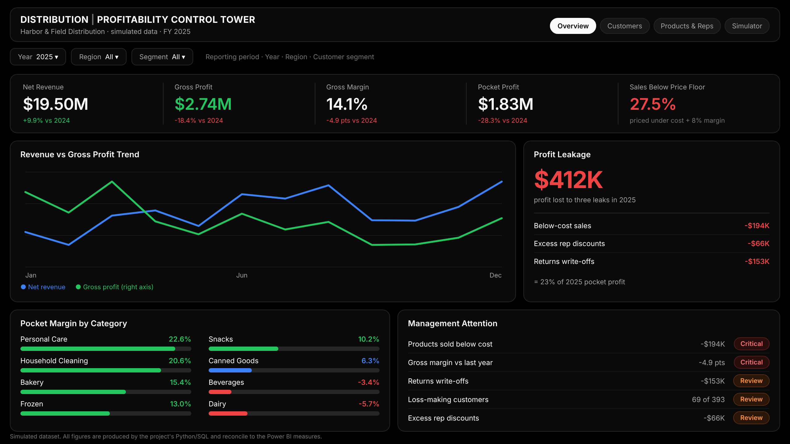
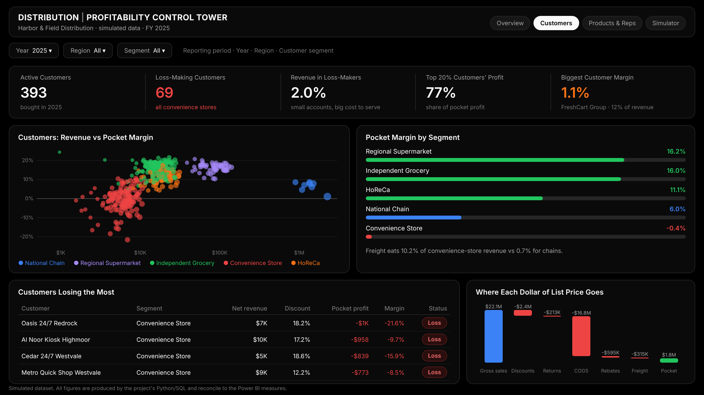
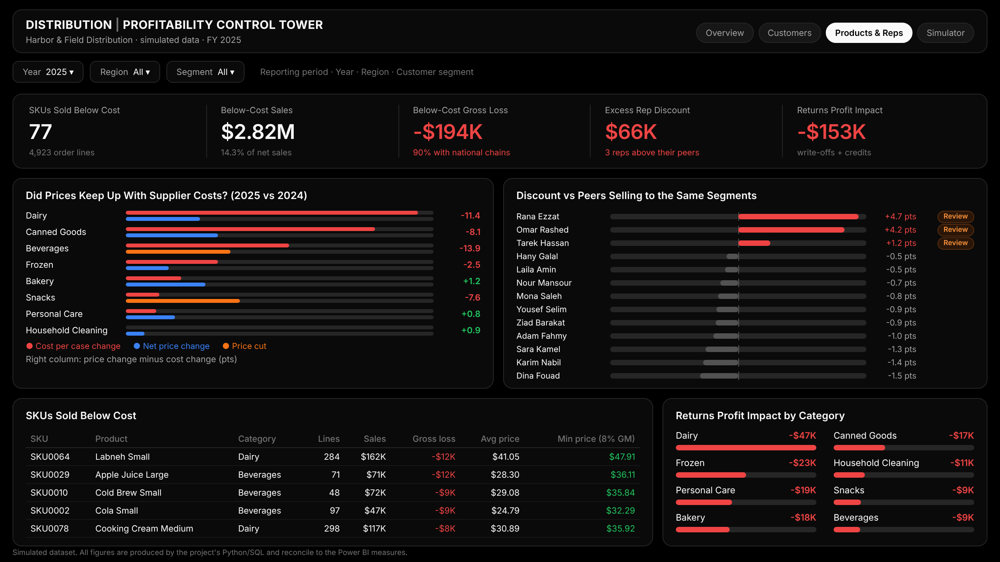
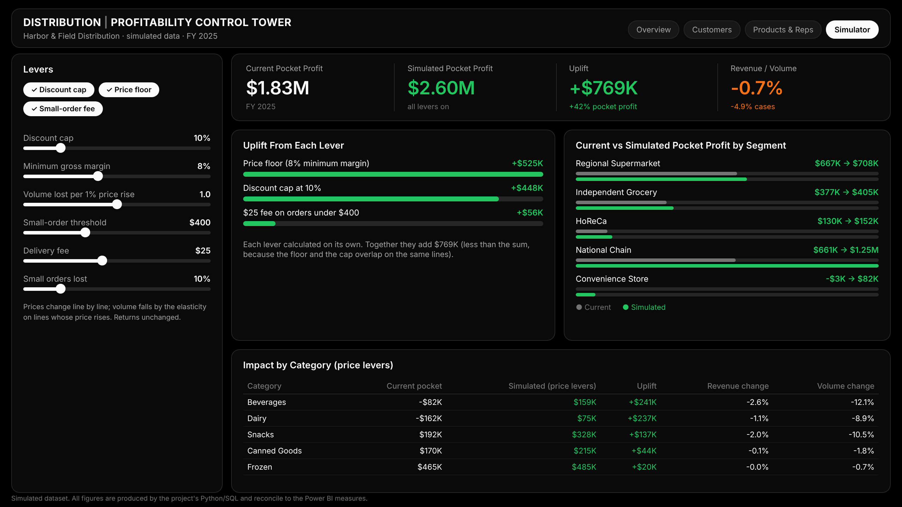

# Power BI Build Guide (Black Edition): Profit Leak Detective

A premium, all-black version of the dashboard: four pages, rounded dark cards, progress-bar lists, status pills and a pill navigation bar. Every page has a mockup rendered from the real 2025 numbers in `docs/mockups/`, so you can compare your build with the target as you go.



| Page | Question it answers |
|---|---|
| Overview | Are we more profitable, or just selling more, and where is profit leaking? |
| Customers | Which customers and segments make or destroy profit? |
| Products & Reps | What is sold below cost, did prices keep up with costs, and who discounts above peers? |
| Simulator | What happens to profit if we change prices, discounts or delivery terms? |

Positions are for a **1280 x 720** canvas: set them in *Format > General > Properties > Size and position*. Build in this order: Steps 1-4 (model and measures), Step 5 (design system), then the pages.

---

## Step 1. Load the data

1. **Get Data > Text/CSV** and load these 9 files from `data/clean/`:
   `dim_date`, `dim_customer`, `dim_product`, `dim_rep`, `dim_product_cost`, `dim_price_list`, `fact_sales`, `fact_returns`, `fact_orders`.
   (Do not load `data_quality_log.csv` into the model. Use it in the README and on a notes page if you add one.)
2. In **Power Query**, check the types:
   - Every `*_date`, `date`, `month_start`, `effective_from`, `effective_to` column: **Date**.
   - Money columns (`gross_sales`, `net_sales`, `cogs`, `unit_cost`, `list_price`, `rebate_amount`, `freight_cost`, `gross_profit`, `pocket_profit`, `credit_amount`, `cost_amount`, `cost_recovered`, `write_off_cost`, `profit_impact`, `order_value`): **Fixed decimal number**.
   - `discount_pct`, `rebate_pct`: **Decimal number**.
   - `quantity`, `return_qty`, `line_id`, `year`, `month_no`: **Whole number**.
3. **Close & Apply**.
4. Select `dim_date` > **Table tools > Mark as date table** > choose `date`.
5. In `dim_date`, set `month_name` to **Sort by column** `month_no`.

## Step 2. Relationships (Model view)

All relationships are **one-to-many, single direction**, from the dimension to the fact.

| From (one side) | To (many side) | Active |
|---|---|---|
| `dim_date[date]` | `fact_sales[order_date]` | Yes |
| `dim_date[date]` | `fact_returns[sale_date]` | Yes |
| `dim_date[date]` | `fact_orders[delivery_date]` | Yes |
| `dim_customer[customer_id]` | `fact_sales[customer_id]` | Yes |
| `dim_customer[customer_id]` | `fact_returns[customer_id]` | Yes |
| `dim_customer[customer_id]` | `fact_orders[customer_id]` | Yes |
| `dim_product[sku]` | `fact_sales[sku]` | Yes |
| `dim_product[sku]` | `fact_returns[sku]` | Yes |
| `dim_rep[rep_id]` | `fact_sales[rep_id]` | Yes |
| `dim_rep[rep_id]` | `fact_returns[rep_id]` | Yes |

Leave `dim_product_cost` and `dim_price_list` unrelated. They are reference tables for drill-through and tooltips.

> **Why `sale_date` for returns:** a return is counted in the year the goods were sold, so a December sale returned in January lowers that December's profit. The Python and SQL use the same rule, so the totals match.

Hide all ID and key columns in the fact tables (right-click > *Hide in report view*). The report should only show dimension columns and measures.

## Step 3. Helper tables

> ⚠️ **Create every table in this step with Modeling > New table, not New measure.** If you paste a `DATATABLE` into a new measure, Power BI shows *"The expression refers to multiple columns. Multiple columns cannot be converted to a scalar value."* Delete that measure and create it again as a table.

**Home > Enter data** is fine for small tables, but DAX tables are easier to rebuild. Use **Modeling > New table** for each one.

```dax
_Measures = { BLANK() }
```
(Create every measure in this table, then hide its one column. It becomes a measure folder.)

```dax
Waterfall Steps =
DATATABLE (
    "Step", STRING, "Order", INTEGER,
    {
        { "Gross sales", 1 }, { "Invoice discounts", 2 }, { "Returns", 3 },
        { "Cost of goods", 4 }, { "Rebates", 5 }, { "Freight", 6 }
    }
)
```

```dax
Attention Items =
DATATABLE (
    "Item", STRING, "Order", INTEGER,
    {
        { "Products sold below cost", 1 },
        { "Excess rep discounts", 2 },
        { "Returns write-offs", 3 },
        { "Loss-making customers", 4 },
        { "Gross margin vs last year", 5 }
    }
)
```

```dax
Levers = DATATABLE ( "Lever", STRING, { { "Discount cap" }, { "Price floor" }, { "Small-order fee" } } )
Lever Chart = DATATABLE ( "Lever", STRING, "Order", INTEGER, { { "Discount cap", 1 }, { "Price floor", 2 }, { "Small-order fee", 3 } } )
```

Set `Step` sorted by `Order`, `Item` sorted by `Order`, and `Lever Chart[Lever]` sorted by `Order`.

### What-if parameters (page 4)

**Modeling > New parameter > Numeric range**. Untick *Add slicer to this page* (you'll add them on page 4 later). Power BI creates the table and a `... Value` measure for each one.

| Name | Data type | Min | Max | Increment | Default |
|---|---|---|---|---|---|
| Discount Cap | Decimal | 0.05 | 0.30 | 0.01 | 0.10 |
| Min Gross Margin | Decimal | 0.00 | 0.20 | 0.01 | 0.08 |
| Elasticity | Decimal | 0.0 | 2.0 | 0.1 | 1.0 |
| Small Order Threshold | Whole | 100 | 1000 | 50 | 400 |
| Delivery Fee | Whole | 0 | 60 | 5 | 25 |
| Small Orders Lost | Decimal | 0.00 | 0.50 | 0.05 | 0.10 |

> **If a `... Value` measure is missing** (error: *"The value for 'Discount Cap Value' cannot be determined"*), the parameter wasn't created or has a different name. Check the Data pane: each parameter must appear as a table (e.g. `Discount Cap`) containing a column and a measure named exactly `Discount Cap Value`. You can also create all six by hand. Make each table with **Modeling > New table**, then each measure with **New measure** in that table:
>
> ```dax
> Discount Cap = GENERATESERIES ( 0.05, 0.30, 0.01 )
> Discount Cap Value = SELECTEDVALUE ( 'Discount Cap'[Value], 0.10 )
>
> Min Gross Margin = GENERATESERIES ( 0, 0.20, 0.01 )
> Min Gross Margin Value = SELECTEDVALUE ( 'Min Gross Margin'[Value], 0.08 )
>
> Elasticity = GENERATESERIES ( 0, 2, 0.1 )
> Elasticity Value = SELECTEDVALUE ( 'Elasticity'[Value], 1 )
>
> Small Order Threshold = GENERATESERIES ( 100, 1000, 50 )
> Small Order Threshold Value = SELECTEDVALUE ( 'Small Order Threshold'[Value], 400 )
>
> Delivery Fee = GENERATESERIES ( 0, 60, 5 )
> Delivery Fee Value = SELECTEDVALUE ( 'Delivery Fee'[Value], 25 )
>
> Small Orders Lost = GENERATESERIES ( 0, 0.50, 0.05 )
> Small Orders Lost Value = SELECTEDVALUE ( 'Small Orders Lost'[Value], 0.10 )
> ```
>
> On page 4, use the `[Value]` column of each table in a slider slicer (*Slicer settings > Style: Single value* for the parameter look).

## Step 4. Measures

Create these in `_Measures`. Put them in display folders (*Properties > Display folder*) as labelled. Format: money as **Currency, 0 decimals**; ratios as **Percentage, 1 decimal**.

### Folder: 1 Base

```dax
Gross Sales = SUM ( fact_sales[gross_sales] )
Discounts = SUM ( fact_sales[discount_amount] )
Net Sales = SUM ( fact_sales[net_sales] )
Return Credit = SUM ( fact_returns[credit_amount] )
Net Revenue = [Net Sales] - [Return Credit]
COGS = SUM ( fact_sales[cogs] ) - SUM ( fact_returns[cost_recovered] )
Gross Profit = [Net Revenue] - [COGS]
Gross Margin % = DIVIDE ( [Gross Profit], [Net Revenue] )
Rebates = SUM ( fact_sales[rebate_amount] )
Freight = SUM ( fact_sales[freight_cost] )
Pocket Profit = [Gross Profit] - [Rebates] - [Freight]
Pocket Margin % = DIVIDE ( [Pocket Profit], [Net Revenue] )
Discount % = DIVIDE ( [Discounts], [Gross Sales] )
Cases = SUM ( fact_sales[quantity] )
Orders = DISTINCTCOUNT ( fact_sales[order_id] )
Avg Order Value = DIVIDE ( [Net Sales], [Orders] )
Active Customers = DISTINCTCOUNT ( fact_sales[customer_id] )
Freight % of Revenue = DIVIDE ( [Freight], [Net Revenue] )
Return Rate % = DIVIDE ( [Return Credit], [Net Sales] )
```

### Folder: 2 Time comparison

```dax
Net Revenue PY = CALCULATE ( [Net Revenue], SAMEPERIODLASTYEAR ( dim_date[date] ) )
Net Revenue YoY % = DIVIDE ( [Net Revenue] - [Net Revenue PY], [Net Revenue PY] )
Gross Profit PY = CALCULATE ( [Gross Profit], SAMEPERIODLASTYEAR ( dim_date[date] ) )
Gross Profit YoY % = DIVIDE ( [Gross Profit] - [Gross Profit PY], [Gross Profit PY] )
Pocket Profit PY = CALCULATE ( [Pocket Profit], SAMEPERIODLASTYEAR ( dim_date[date] ) )
Pocket Profit YoY % = DIVIDE ( [Pocket Profit] - [Pocket Profit PY], [Pocket Profit PY] )
Gross Margin PY % = CALCULATE ( [Gross Margin %], SAMEPERIODLASTYEAR ( dim_date[date] ) )
Gross Margin Change pts = ( [Gross Margin %] - [Gross Margin PY %] ) * 100

-- invoice-level margin per case (before returns), used for the cost pass-through chart
Net Price per Case = DIVIDE ( [Net Sales], [Cases] )
Cost per Case = DIVIDE ( SUM ( fact_sales[cogs] ), [Cases] )
Net Price Change % = DIVIDE ( [Net Price per Case], CALCULATE ( [Net Price per Case], SAMEPERIODLASTYEAR ( dim_date[date] ) ) ) - 1
Cost Change % = DIVIDE ( [Cost per Case], CALCULATE ( [Cost per Case], SAMEPERIODLASTYEAR ( dim_date[date] ) ) ) - 1
Invoice Margin % = 1 - DIVIDE ( SUM ( fact_sales[cogs] ), [Net Sales] )
Invoice Margin Change pts =
    ( [Invoice Margin %] - CALCULATE ( [Invoice Margin %], SAMEPERIODLASTYEAR ( dim_date[date] ) ) ) * 100
```

### Folder: 3 Profit leaks

```dax
Below-Cost Sales =
SUMX (
    FILTER ( fact_sales, fact_sales[net_sales] < fact_sales[unit_cost] * fact_sales[quantity] ),
    fact_sales[net_sales]
)

Below-Cost Gross Loss =
SUMX (
    FILTER ( fact_sales, fact_sales[net_sales] < fact_sales[unit_cost] * fact_sales[quantity] ),
    fact_sales[net_sales] - fact_sales[unit_cost] * fact_sales[quantity]
)

Below-Cost Lines =
COUNTROWS ( FILTER ( fact_sales, fact_sales[net_sales] < fact_sales[unit_cost] * fact_sales[quantity] ) )

SKUs Sold Below Cost =
CALCULATE (
    DISTINCTCOUNT ( fact_sales[sku] ),
    FILTER ( fact_sales, fact_sales[net_sales] < fact_sales[unit_cost] * fact_sales[quantity] )
)

Min Price (8% GM) = DIVIDE ( AVERAGE ( fact_sales[unit_cost] ), 1 - 0.08 )
Avg Net Price = DIVIDE ( [Net Sales], [Cases] )

-- discount rate of field reps selling to the same segment (the "peer" rate)
Segment Discount Rate (Field) =
CALCULATE (
    [Discount %],
    REMOVEFILTERS ( dim_rep ),
    dim_rep[role] = "Field Sales Rep",
    REMOVEFILTERS ( dim_customer ),
    VALUES ( dim_customer[segment] )
)

Expected Discount =
SUMX ( VALUES ( dim_customer[segment] ), [Gross Sales] * [Segment Discount Rate (Field)] )

Excess Discount $ =
CALCULATE ( [Discounts] - [Expected Discount], KEEPFILTERS ( dim_rep[role] = "Field Sales Rep" ) )

Excess Discount pts = DIVIDE ( [Excess Discount $], [Gross Sales] ) * 100

-- only the reps above their peers count as leakage
Excess Discount (Generous Reps) =
SUMX ( VALUES ( dim_rep[rep_id] ), MAX ( 0, [Excess Discount $] ) )

Returns Profit Impact = SUM ( fact_returns[profit_impact] )
Return Write-offs = SUM ( fact_returns[write_off_cost] )

Profit Leakage =
ABS ( [Below-Cost Gross Loss] ) + [Excess Discount (Generous Reps)] + ABS ( [Returns Profit Impact] )
```

### Folder: 4 Customers

```dax
Loss-Making Customers =
COUNTROWS ( FILTER ( VALUES ( dim_customer[customer_id] ), [Pocket Profit] < 0 ) )

Revenue in Loss-Making Customers % =
DIVIDE (
    SUMX ( FILTER ( VALUES ( dim_customer[customer_id] ), [Pocket Profit] < 0 ), [Net Revenue] ),
    [Net Revenue]
)

Top 20% Share of Pocket Profit =
VAR Cust =
    FILTER (
        ADDCOLUMNS ( VALUES ( dim_customer[customer_id] ), "@p", [Pocket Profit] ),
        NOT ISBLANK ( [@p] )
    )
VAR TopCust = TOPN ( ROUNDDOWN ( COUNTROWS ( Cust ) * 0.2, 0 ), Cust, [@p], DESC )
RETURN DIVIDE ( SUMX ( TopCust, [@p] ), SUMX ( Cust, [@p] ) )

Cumulative Profit Share =
VAR Cur = [Pocket Profit]
VAR Cust =
    FILTER (
        ADDCOLUMNS ( ALLSELECTED ( dim_customer[customer_name] ), "@p", [Pocket Profit] ),
        NOT ISBLANK ( [@p] )
    )
RETURN
    IF ( NOT ISBLANK ( Cur ), DIVIDE ( SUMX ( FILTER ( Cust, [@p] >= Cur ), [@p] ), SUMX ( Cust, [@p] ) ) )
```

### Folder: 5 Visual helpers

```dax
Waterfall Value =
SWITCH (
    SELECTEDVALUE ( 'Waterfall Steps'[Step] ),
    "Gross sales", [Gross Sales],
    "Invoice discounts", - [Discounts],
    "Returns", - [Return Credit],
    "Cost of goods", - [COGS],
    "Rebates", - [Rebates],
    "Freight", - [Freight]
)

Attention Value =
SWITCH (
    SELECTEDVALUE ( 'Attention Items'[Item] ),
    "Products sold below cost", [Below-Cost Gross Loss],
    "Excess rep discounts", - [Excess Discount (Generous Reps)],
    "Returns write-offs", [Returns Profit Impact],
    "Loss-making customers", [Loss-Making Customers],
    "Gross margin vs last year", [Gross Margin Change pts]
)

Attention Display =
VAR v = [Attention Value]
RETURN
SWITCH (
    SELECTEDVALUE ( 'Attention Items'[Item] ),
    "Loss-making customers", FORMAT ( v, "#,0" ) & " customers",
    "Gross margin vs last year", FORMAT ( v, "+0.0;-0.0" ) & " pts",
    FORMAT ( v, "$#,0;-$#,0" )
)

Attention Status =
VAR _item = SELECTEDVALUE ( 'Attention Items'[Item] )
VAR v = [Attention Value]
VAR crit = 0.10 * [Pocket Profit]          -- a leak worth 10% of pocket profit is critical
RETURN
SWITCH (
    TRUE (),
    _item = "Gross margin vs last year", IF ( v <= -2, "Critical", IF ( v < 0, "Review", "OK" ) ),
    _item = "Loss-making customers", IF ( v >= 0.25 * [Active Customers], "Critical", IF ( v > 0, "Review", "OK" ) ),
    ABS ( v ) >= crit, "Critical",
    v < 0, "Review",
    "OK"
)

Attention Status Color =
SWITCH ( [Attention Status], "Critical", "#EF4444", "Review", "#F59E0B", "#22C55E" )

Margin Color = IF ( [Pocket Margin %] < 0, "#EF4444", IF ( [Pocket Margin %] < 0.08, "#F59E0B", "#22C55E" ) )
Change Color = IF ( [Invoice Margin Change pts] < 0, "#EF4444", "#22C55E" )
Rep Color = IF ( [Excess Discount pts] > 1, "#EF4444", "#3B82F6" )

Report Subtitle =
"Harbor & Field Distribution (simulated data)  |  " &
IF ( HASONEVALUE ( dim_date[year] ), "FY " & VALUES ( dim_date[year] ), "FY 2023-2025" )
```

### Folder: 6 Simulator

The simulator changes prices line by line, so a price rise on one line only loses volume on that line. Returns are left unchanged.

```dax
Sim Pocket (Price Levers) =
VAR CapOn = "Discount cap" IN VALUES ( Levers[Lever] )
VAR FloorOn = "Price floor" IN VALUES ( Levers[Lever] )
VAR Cap = [Discount Cap Value]
VAR MinGM = [Min Gross Margin Value]
VAR E = [Elasticity Value]
RETURN
SUMX (
    fact_sales,
    VAR Qty = fact_sales[quantity]
    VAR NetPrice = DIVIDE ( fact_sales[net_sales], Qty )
    VAR P1 = IF ( CapOn, MAX ( NetPrice, fact_sales[list_price] * ( 1 - Cap ) ), NetPrice )
    VAR P2 = IF ( FloorOn, MAX ( P1, DIVIDE ( fact_sales[unit_cost], 1 - MinGM ) ), P1 )
    VAR Keep = MAX ( 0, 1 - E * ( DIVIDE ( P2, NetPrice ) - 1 ) )
    VAR NewQty = Qty * Keep
    VAR RebRate = DIVIDE ( fact_sales[rebate_amount], fact_sales[net_sales] )
    RETURN P2 * NewQty * ( 1 - RebRate ) - fact_sales[unit_cost] * NewQty - fact_sales[freight_cost] * Keep
)

Sim Net Sales =
VAR CapOn = "Discount cap" IN VALUES ( Levers[Lever] )
VAR FloorOn = "Price floor" IN VALUES ( Levers[Lever] )
VAR Cap = [Discount Cap Value]
VAR MinGM = [Min Gross Margin Value]
VAR E = [Elasticity Value]
RETURN
SUMX (
    fact_sales,
    VAR Qty = fact_sales[quantity]
    VAR NetPrice = DIVIDE ( fact_sales[net_sales], Qty )
    VAR P1 = IF ( CapOn, MAX ( NetPrice, fact_sales[list_price] * ( 1 - Cap ) ), NetPrice )
    VAR P2 = IF ( FloorOn, MAX ( P1, DIVIDE ( fact_sales[unit_cost], 1 - MinGM ) ), P1 )
    VAR Keep = MAX ( 0, 1 - E * ( DIVIDE ( P2, NetPrice ) - 1 ) )
    RETURN P2 * Qty * Keep
)

Sim Cases =
VAR CapOn = "Discount cap" IN VALUES ( Levers[Lever] )
VAR FloorOn = "Price floor" IN VALUES ( Levers[Lever] )
VAR Cap = [Discount Cap Value]
VAR MinGM = [Min Gross Margin Value]
VAR E = [Elasticity Value]
RETURN
SUMX (
    fact_sales,
    VAR NetPrice = DIVIDE ( fact_sales[net_sales], fact_sales[quantity] )
    VAR P1 = IF ( CapOn, MAX ( NetPrice, fact_sales[list_price] * ( 1 - Cap ) ), NetPrice )
    VAR P2 = IF ( FloorOn, MAX ( P1, DIVIDE ( fact_sales[unit_cost], 1 - MinGM ) ), P1 )
    RETURN fact_sales[quantity] * MAX ( 0, 1 - E * ( DIVIDE ( P2, NetPrice ) - 1 ) )
)

Price Lever Uplift = [Sim Pocket (Price Levers)] - SUM ( fact_sales[pocket_profit] )

Small Order Fee Effect (always on) =
VAR Thr = [Small Order Threshold Value]
VAR Fee = [Delivery Fee Value]
VAR Lost = [Small Orders Lost Value]
VAR OrdersT =
    ADDCOLUMNS (
        VALUES ( fact_sales[order_id] ),
        "@net", CALCULATE ( SUM ( fact_sales[net_sales] ) ),
        "@pocket", CALCULATE ( SUM ( fact_sales[pocket_profit] ) )
    )
VAR SmallT = FILTER ( OrdersT, [@net] < Thr )
RETURN COUNTROWS ( SmallT ) * ( 1 - Lost ) * Fee - SUMX ( SmallT, [@pocket] ) * Lost

Sim Fee Effect =
IF ( "Small-order fee" IN VALUES ( Levers[Lever] ), [Small Order Fee Effect (always on)], 0 )

Simulated Pocket Profit = [Pocket Profit] + [Price Lever Uplift] + [Sim Fee Effect]
Simulator Uplift = [Simulated Pocket Profit] - [Pocket Profit]
Simulator Uplift % = DIVIDE ( [Simulator Uplift], [Pocket Profit] )
Sim Revenue Change % = DIVIDE ( [Sim Net Sales], [Net Sales] ) - 1
Sim Volume Change % = DIVIDE ( [Sim Cases], [Cases] ) - 1

-- one bar per lever, each calculated on its own (ignores the Levers slicer)
Lever Effect =
VAR _lever = SELECTEDVALUE ( 'Lever Chart'[Lever] )
RETURN
SWITCH (
    _lever,
    "Discount cap", CALCULATE ( [Price Lever Uplift], TREATAS ( { "Discount cap" }, Levers[Lever] ) ),
    "Price floor", CALCULATE ( [Price Lever Uplift], TREATAS ( { "Price floor" }, Levers[Lever] ) ),
    "Small-order fee", [Small Order Fee Effect (always on)]
)
```


### Folder: 7 Black-design measures

These measures add the numbers used by the new layout. Add them to `_Measures` with the others.

```dax
Sales Below Price Floor % =
DIVIDE (
    SUMX (
        FILTER ( fact_sales, fact_sales[net_sales] < fact_sales[unit_cost] * fact_sales[quantity] / ( 1 - 0.08 ) ),
        fact_sales[net_sales]
    ),
    [Net Sales]
)

Below-Cost Sales % = DIVIDE ( [Below-Cost Sales], [Net Sales] )
Leakage % of Pocket Profit = DIVIDE ( [Profit Leakage], [Pocket Profit] )

Biggest Customer Pocket Margin =
VAR TopCust = TOPN ( 1, VALUES ( dim_customer[customer_id] ), [Net Revenue], DESC )
RETURN CALCULATE ( [Pocket Margin %], TopCust )

Biggest Customer Label =
VAR TopCust = TOPN ( 1, VALUES ( dim_customer[customer_id] ), [Net Revenue], DESC )
VAR nm = CALCULATE ( SELECTEDVALUE ( dim_customer[customer_name] ), TopCust )
VAR share = DIVIDE ( CALCULATE ( [Net Revenue], TopCust ), [Net Revenue] )
RETURN nm & " · " & FORMAT ( share, "0%" ) & " of revenue"

Price minus Cost pts = ( [Net Price Change %] - [Cost Change %] ) * 100
Category Rank = RANKX ( ALLSELECTED ( dim_product[category] ), [Pocket Margin %], , DESC, DENSE )
Returns Rank = RANKX ( ALLSELECTED ( dim_product[category] ), [Returns Profit Impact], , ASC, DENSE )

-- reference labels under the KPI values ("+9.9% vs PY")
Net Revenue YoY Label = FORMAT ( [Net Revenue YoY %], "+0.0%;-0.0%" ) & " vs PY"
Gross Profit YoY Label = FORMAT ( [Gross Profit YoY %], "+0.0%;-0.0%" ) & " vs PY"
Gross Margin Change Label = FORMAT ( [Gross Margin Change pts], "+0.0;-0.0" ) & " pts vs PY"
Pocket Profit YoY Label = FORMAT ( [Pocket Profit YoY %], "+0.0%;-0.0%" ) & " vs PY"
YoY Color = IF ( [Net Revenue YoY %] >= 0, "#22C55E", "#EF4444" )
GP YoY Color = IF ( [Gross Profit YoY %] >= 0, "#22C55E", "#EF4444" )
Pocket YoY Color = IF ( [Pocket Profit YoY %] >= 0, "#22C55E", "#EF4444" )
GM Change Color = IF ( [Gross Margin Change pts] >= 0, "#22C55E", "#EF4444" )

-- fixed text for reference labels
Floor Label = "priced under cost + 8% margin"
Leak Label = "profit lost to three leaks"

-- simulator table by category (price levers only)
Sim Pocket (price only) = [Pocket Profit] + [Price Lever Uplift]
```

And add one more helper table for the Profit Leakage card:

```dax
Leak Items =   -- Modeling > New table
DATATABLE ( "Item", STRING, "Order", INTEGER,
    { { "Below-cost sales", 1 }, { "Excess rep discounts", 2 }, { "Returns write-offs", 3 } } )
```

```dax
Leak Value =
SWITCH (
    SELECTEDVALUE ( 'Leak Items'[Item] ),
    "Below-cost sales", [Below-Cost Gross Loss],
    "Excess rep discounts", - [Excess Discount (Generous Reps)],
    "Returns write-offs", [Returns Profit Impact]
)
```

Sort `Leak Items[Item]` by `Order`.

### Folder: 8 SVG visuals (the progress bars and pills)

Power BI has no progress-bar or pill visual, so these measures draw them as small SVG images. Two rules make them work:

1. After creating each measure, select it and set **Measure tools > Data category = Image URL**.
2. Put it in a **Table** visual, then in *Format > Image size* set the height and width given next to each measure.

Colours inside the SVG are written `%23RRGGBB` (`%23` is `#`), and `%25` is `%`. Don't change that or the image won't render.

**Category bar** (label, value and bar in one image, like the reference design). Image size **34 x 280**.

```dax
SVG Category Bar =
VAR lbl = SELECTEDVALUE ( dim_product[category] )
VAR v = [Pocket Margin %]
VAR c = IF ( v < 0, "%23EF4444", IF ( v < 0.10, "%233B82F6", "%2322C55E" ) )
VAR w = INT ( MIN ( ABS ( v ) / 0.25, 1 ) * 280 )
VAR pct = SUBSTITUTE ( FORMAT ( v, "0.0%" ), "%", "%25" )
RETURN
"data:image/svg+xml;utf8,<svg xmlns='http://www.w3.org/2000/svg' width='280' height='34'>" &
"<text x='0' y='13' font-family='Segoe UI' font-size='12' fill='%23FAFAFA'>" & lbl & "</text>" &
"<text x='280' y='13' text-anchor='end' font-family='Segoe UI' font-size='12' font-weight='600' fill='" & c & "'>" & pct & "</text>" &
"<rect x='0' y='22' width='280' height='7' rx='3.5' fill='%23262626'/>" &
"<rect x='0' y='22' width='" & w & "' height='7' rx='3.5' fill='" & c & "'/></svg>"
```

**Segment bar** (same design, wider). Image size **34 x 580**.

```dax
SVG Segment Bar =
VAR lbl = SELECTEDVALUE ( dim_customer[segment] )
VAR v = [Pocket Margin %]
VAR c = IF ( v < 0, "%23EF4444", IF ( v < 0.10, "%233B82F6", "%2322C55E" ) )
VAR w = INT ( MIN ( ABS ( v ) / 0.20, 1 ) * 580 )
VAR pct = SUBSTITUTE ( FORMAT ( v, "0.0%" ), "%", "%25" )
RETURN
"data:image/svg+xml;utf8,<svg xmlns='http://www.w3.org/2000/svg' width='580' height='34'>" &
"<text x='0' y='13' font-family='Segoe UI' font-size='12' fill='%23FAFAFA'>" & lbl & "</text>" &
"<text x='580' y='13' text-anchor='end' font-family='Segoe UI' font-size='12' font-weight='600' fill='" & c & "'>" & pct & "</text>" &
"<rect x='0' y='22' width='580' height='7' rx='3.5' fill='%23262626'/>" &
"<rect x='0' y='22' width='" & w & "' height='7' rx='3.5' fill='" & c & "'/></svg>"
```

**Returns bar** (red, scaled to the worst category). Image size **34 x 180**.

```dax
SVG Returns Bar =
VAR lbl = SELECTEDVALUE ( dim_product[category] )
VAR v = [Returns Profit Impact]
VAR mx = MAXX ( ALLSELECTED ( dim_product[category] ), ABS ( [Returns Profit Impact] ) )
VAR w = INT ( DIVIDE ( ABS ( v ), mx ) * 180 )
VAR txt = "-$" & FORMAT ( ABS ( v ) / 1000, "#,0" ) & "K"
RETURN
"data:image/svg+xml;utf8,<svg xmlns='http://www.w3.org/2000/svg' width='180' height='34'>" &
"<text x='0' y='13' font-family='Segoe UI' font-size='12' fill='%23FAFAFA'>" & lbl & "</text>" &
"<text x='180' y='13' text-anchor='end' font-family='Segoe UI' font-size='12' font-weight='600' fill='%23EF4444'>" & txt & "</text>" &
"<rect x='0' y='22' width='180' height='7' rx='3.5' fill='%23262626'/>" &
"<rect x='0' y='22' width='" & w & "' height='7' rx='3.5' fill='%23EF4444'/></svg>"
```

**Status pill for the Management Attention list.** Image size **22 x 72**.

```dax
SVG Attention Pill =
VAR s = [Attention Status]
VAR fg = SWITCH ( s, "Critical", "%23F87171", "Review", "%23FB923C", "%234ADE80" )
VAR bg = SWITCH ( s, "Critical", "%232A0E0E", "Review", "%232A1608", "%2306210F" )
VAR bd = SWITCH ( s, "Critical", "%235B1C1C", "Review", "%235A2E10", "%2314532D" )
RETURN
"data:image/svg+xml;utf8,<svg xmlns='http://www.w3.org/2000/svg' width='72' height='22'>" &
"<rect x='1' y='1' width='70' height='20' rx='10' fill='" & bg & "' stroke='" & bd & "'/>" &
"<text x='36' y='15' text-anchor='middle' font-family='Segoe UI' font-size='11' font-weight='600' fill='" & fg & "'>" & s & "</text></svg>"
```

**Customer status pill** (Loss / Thin / Healthy). Image size **22 x 72**.

```dax
SVG Customer Pill =
VAR s = IF ( [Pocket Profit] < 0, "Loss", IF ( [Pocket Margin %] < 0.08, "Thin", "Healthy" ) )
VAR fg = SWITCH ( s, "Loss", "%23F87171", "Thin", "%23FB923C", "%234ADE80" )
VAR bg = SWITCH ( s, "Loss", "%232A0E0E", "Thin", "%232A1608", "%2306210F" )
VAR bd = SWITCH ( s, "Loss", "%235B1C1C", "Thin", "%235A2E10", "%2314532D" )
RETURN
"data:image/svg+xml;utf8,<svg xmlns='http://www.w3.org/2000/svg' width='72' height='22'>" &
"<rect x='1' y='1' width='70' height='20' rx='10' fill='" & bg & "' stroke='" & bd & "'/>" &
"<text x='36' y='15' text-anchor='middle' font-family='Segoe UI' font-size='11' font-weight='600' fill='" & fg & "'>" & s & "</text></svg>"
```

**Rep diverging bar** (centre line = peer average; red to the right = discounts above peers). Image size **16 x 300**.

```dax
SVG Rep Bar =
VAR v = [Excess Discount pts]
VAR w = INT ( MIN ( ABS ( v ) / 5, 1 ) * 150 )
VAR x = IF ( v >= 0, 150, 150 - w )
VAR c = IF ( v > 1, "%23EF4444", "%23525252" )
RETURN
"data:image/svg+xml;utf8,<svg xmlns='http://www.w3.org/2000/svg' width='300' height='16'>" &
"<rect x='0' y='5' width='300' height='7' rx='3.5' fill='%23262626'/>" &
"<rect x='" & x & "' y='5' width='" & w & "' height='7' rx='3.5' fill='" & c & "'/>" &
"<line x1='150' x2='150' y1='1' y2='15' stroke='%23737373'/></svg>"

SVG Rep Pill =
IF (
    [Excess Discount pts] > 1,
    "data:image/svg+xml;utf8,<svg xmlns='http://www.w3.org/2000/svg' width='60' height='16'>" &
    "<rect x='1' y='1' width='58' height='14' rx='7' fill='%232A1608' stroke='%235A2E10'/>" &
    "<text x='30' y='11.5' text-anchor='middle' font-family='Segoe UI' font-size='9' font-weight='600' fill='%23FB923C'>Review</text></svg>"
)
```

**Cost vs price bars** (two thin bars per category: cost red, price blue, orange when the price fell). Image size **18 x 300**.

```dax
SVG Cost vs Price =
VAR cst = [Cost Change %]
VAR prc = [Net Price Change %]
VAR wc = INT ( MIN ( ABS ( cst ) / 0.16, 1 ) * 300 )
VAR wp = INT ( MIN ( ABS ( prc ) / 0.16, 1 ) * 300 )
VAR cp = IF ( prc < 0, "%23F97316", "%233B82F6" )
RETURN
"data:image/svg+xml;utf8,<svg xmlns='http://www.w3.org/2000/svg' width='300' height='18'>" &
"<rect x='0' y='2' width='300' height='5' rx='2.5' fill='%23262626'/>" &
"<rect x='0' y='2' width='" & wc & "' height='5' rx='2.5' fill='%23EF4444'/>" &
"<rect x='0' y='11' width='300' height='5' rx='2.5' fill='%23262626'/>" &
"<rect x='0' y='11' width='" & wp & "' height='5' rx='2.5' fill='" & cp & "'/></svg>"
```

**Lever uplift bar** (simulator). Image size **34 x 400**.

```dax
SVG Lever Bar =
VAR lbl = SELECTEDVALUE ( 'Lever Chart'[Lever] )
VAR v = [Lever Effect]
VAR mx = MAXX ( ALL ( 'Lever Chart'[Lever] ), [Lever Effect] )
VAR w = INT ( DIVIDE ( MAX ( v, 0 ), mx ) * 400 )
VAR txt = "+$" & FORMAT ( v / 1000, "#,0" ) & "K"
RETURN
"data:image/svg+xml;utf8,<svg xmlns='http://www.w3.org/2000/svg' width='400' height='34'>" &
"<text x='0' y='13' font-family='Segoe UI' font-size='12' fill='%23FAFAFA'>" & lbl & "</text>" &
"<text x='400' y='13' text-anchor='end' font-family='Segoe UI' font-size='12' font-weight='600' fill='%2322C55E'>" & txt & "</text>" &
"<rect x='0' y='22' width='400' height='7' rx='3.5' fill='%23262626'/>" &
"<rect x='0' y='22' width='" & w & "' height='7' rx='3.5' fill='%2322C55E'/></svg>"
```

**Current vs simulated, by segment** (grey bar = now, green bar = simulated). Image size **44 x 420**.

```dax
SVG Segment Sim =
VAR lbl = SELECTEDVALUE ( dim_customer[segment] )
VAR a = [Pocket Profit]
VAR b = [Simulated Pocket Profit]
VAR mx = MAXX ( ALLSELECTED ( dim_customer[segment] ), [Simulated Pocket Profit] )
VAR wa = INT ( DIVIDE ( MAX ( a, 0 ), mx ) * 420 )
VAR wb = INT ( DIVIDE ( MAX ( b, 0 ), mx ) * 420 )
VAR fa = IF ( ABS ( a ) >= 1000000, FORMAT ( a / 1000000, "$#,0.00" ) & "M", FORMAT ( a / 1000, "$#,0" ) & "K" )
VAR fb = IF ( ABS ( b ) >= 1000000, FORMAT ( b / 1000000, "$#,0.00" ) & "M", FORMAT ( b / 1000, "$#,0" ) & "K" )
RETURN
"data:image/svg+xml;utf8,<svg xmlns='http://www.w3.org/2000/svg' width='420' height='44'>" &
"<text x='0' y='13' font-family='Segoe UI' font-size='12' fill='%23FAFAFA'>" & lbl & "</text>" &
"<text x='420' y='13' text-anchor='end' font-family='Segoe UI' font-size='12' font-weight='600' fill='%2322C55E'>" & fa & " %E2%86%92 " & fb & "</text>" &
"<rect x='0' y='22' width='420' height='5' rx='2.5' fill='%23262626'/>" &
"<rect x='0' y='22' width='" & wa & "' height='5' rx='2.5' fill='%23737373'/>" &
"<rect x='0' y='31' width='420' height='5' rx='2.5' fill='%23262626'/>" &
"<rect x='0' y='31' width='" & wb & "' height='5' rx='2.5' fill='%2322C55E'/></svg>"
```

---

## Step 5. The black design system

The look comes from five rules. Apply them to every visual and the four pages will feel like one product.

| Element | Setting |
|---|---|
| Page background | `#000000` (pure black) |
| Card (every visual) | background `#0A0A0A`, border 1 px `#262626`, **rounded corners 12**, no shadow, padding 12-14 |
| Text | titles `#FAFAFA` Segoe UI Semibold 11; labels `#A3A3A3` 9; secondary `#737373` |
| Colour meaning | green `#22C55E` good · red `#EF4444` loss/leak · blue `#3B82F6` neutral series · orange `#F97316` warning · grey `#525252` "current" or "normal" |
| Spacing | 16 px page margin, 12 px between cards |

1. **View > Themes > Browse for themes** > `powerbi/control_tower_black_theme.json`. This sets the black page, the card style and the table colours for you.
2. **Format page > Canvas settings**: 16:9, 1280 x 720.
3. Build page 1 fully, then **duplicate the page** for pages 2-4 so the header, nav and filters stay pixel-identical.

### Components used on every page

**Header bar** (x16 y12 w1248 h56)
- *Insert > Shapes > Rounded rectangle*: fill `#0A0A0A`, border `#262626` 1 px, rounded corners 12.
- Text box on top (x30 y18): "DISTRIBUTION | PROFITABILITY CONTROL TOWER", Segoe UI Bold 13, white. Colour the "|" grey `#737373`.
- Card (new) under it (x30 y40 w500 h22): `[Report Subtitle]`, 9 pt `#A3A3A3`, no background, no label.

**Navigation pills** (x856 y22 w396 h36)
- *Insert > Buttons > Navigator > Page navigator*.
- *Format > Style > Default*: fill `#171717`, text `#A3A3A3` 9 pt, border `#262626`, **shape: Pill** (or rounded corners 18).
- *Selected* state: fill `#FAFAFA`, text `#000000` Semibold. *Hover*: fill `#262626`.
- Rename the pages: Overview, Customers, Products & Reps, Simulator.

**Filters row** (y76, pages 1-3)
| Slicer | Field | Position |
|---|---|---|
| Year | `dim_date[year]` | x16 y76 w110 h32 |
| Region | `dim_customer[region]` | x134 y76 w120 h32 |
| Segment | `dim_customer[segment]` | x262 y76 w140 h32 |

Style *Dropdown*, slicer header **off**, values 9 pt white, background `#0A0A0A`, border `#262626` with rounded corners 8. Put the field name in the dropdown placeholder by turning the header off and adding a tiny grey text box inside the left of each slicer, or keep the header on at 8 pt grey if you prefer. Add a text box at x414 y82: "Reporting period · Year · Region · Customer segment" in `#737373` 9 pt. Sync the three slicers across pages 1-3 (*View > Sync slicers*). Default Year = 2025.

**KPI strip** (x16 y120 w1248 h96)
- Rounded rectangle shape behind it (same card style).
- One **Card (new)** visual on top (x24 y124 w1232 h88) with the 5 measures for that page in the *Data* well. *Format > Cards*: layout **horizontal**, background off, border off, accent bar off.
- *Callout value*: Segoe UI Semibold 22, white (use the green/red overrides listed per page).
- *Label*: 9 pt `#A3A3A3`, position **above** the value.
- *Reference labels*: add the label measure for each card (e.g. `[Net Revenue YoY Label]`), 8 pt, colour *fx* by the matching colour measure. Reference labels need a field, so for fixed text create a text measure, e.g. `Floor Label = "priced under cost + 8% margin"`.
- Dividers: if your version of the new card has a **Divider** option, turn it on (1 px `#262626`). If not, add 4 thin vertical line shapes (1 px, `#262626`, height 64) between the cards.

> If you don't have Card (new), use five classic cards with transparent backgrounds on top of the rectangle, and a second small card under each for the reference label.

**Tables used as "lists"** (bars, attention list, leakage list)
- *Style presets*: None. *Grid*: horizontal lines `#171717`, vertical off, outline off.
- *Column headers*: **off** for the SVG lists, on (8 pt `#737373`) for the data tables.
- *Values*: 9-10 pt white, background `#0A0A0A`, alternate background `#0A0A0A` (no zebra stripes).
- Scrollbar: *Format > Visual > Scrollbar* off where possible, and size the visual so all rows fit.
- **Every SVG list needs its row field in the table** (category, segment or lever), even though you hide it. Without it the table has one total row and the measure draws one empty bar. **Sorting a list by a measure you don't want to show:** add that measure as a column, sort by it, then drag its column edge to width 0.

**Footer note** (x16 y704 w800 h14): text box "Simulated dataset. All figures reconcile to the project's Python and SQL." 8 pt `#737373`.

---

## Page 1. Overview


| Visual | Fields | Position | Formatting |
|---|---|---|---|
| Card (new), 5 callouts | `[Net Revenue]`, `[Gross Profit]`, `[Gross Margin %]`, `[Pocket Profit]`, `[Sales Below Price Floor %]` | KPI strip | Reference labels: `[Net Revenue YoY Label]`, `[Gross Profit YoY Label]`, `[Gross Margin Change Label]`, `[Pocket Profit YoY Label]`, `[Floor Label]`. Callout colour: Gross Profit **green**, Sales Below Price Floor **red** |
| Line chart | X: `dim_date[month_name]`. Y: `[Net Revenue]`. Secondary Y: `[Gross Profit]` | x16 y228 w820 h262 | Title "Revenue vs Gross Profit Trend". Lines: Net Revenue `#3B82F6`, Gross Profit `#22C55E`, **stroke width 3**, markers off, *Interpolation: Smooth* if available. Y axes and their titles **off**; gridlines `#1C1C1C`; X labels grey; legend bottom-left |
| Rounded rectangle | | x848 y228 w416 h262 | card style (container for the leakage block) |
| Text box | "Profit Leakage" | x864 y240 | 11 pt Semibold white |
| Card (new) | `[Profit Leakage]` | x860 y262 w392 h60 | Callout **36 pt, red `#EF4444`**, label off, background off. Reference label: `[Leak Label]` 9 pt grey |
| Table | `'Leak Items'[Item]`, `[Leak Value]` | x860 y336 w392 h108 | Headers off, `[Leak Value]` font colour red, right-aligned, format `$#,0` |
| Card (new) | `[Leakage % of Pocket Profit]` | x860 y448 w392 h32 | 9 pt grey, label "of pocket profit" |
| Rounded rectangle + text box | "Pocket Margin by Category" | x16 y502 w616 h198 | card style; title text box at x30 y512 |
| Table | `dim_product[category]` + `[SVG Category Bar]` + `[Category Rank]` (category and rank columns at width 0) | x28 y532 w296 h164 | Transparent (background and border off). Visual filter: `[Category Rank]` ≤ 4. Sort by Category Rank ascending. Headers off. Image 34 x 280 |
| Table | same | x332 y532 w296 h164 | Transparent. Visual filter: `[Category Rank]` > 4 |
| Table | `'Attention Items'[Item]`, `[Attention Display]`, `[SVG Attention Pill]` | x644 y502 w620 h198 | Title "Management Attention". Headers off. Attention Display grey `#A3A3A3`, right-aligned. Image 22 x 72 |

> The two transparent tables sit on one rounded rectangle, so the eight bars read as a single two-column card, like the reference design.

## Page 2. Customers



| Visual | Fields | Position | Formatting |
|---|---|---|---|
| Card (new), 5 callouts | `[Active Customers]`, `[Loss-Making Customers]`, `[Revenue in Loss-Making Customers %]`, `[Top 20% Share of Pocket Profit]`, `[Biggest Customer Pocket Margin]` | KPI strip | Loss-Making Customers **red**, Biggest Customer Margin **orange**. Reference label for the last one: `[Biggest Customer Label]` |
| Scatter | Values: `dim_customer[customer_name]`. X: `[Net Revenue]`. Y: `[Pocket Margin %]`. Size: `[Orders]`. Legend: `dim_customer[segment]` | x16 y228 w620 h270 | Title "Customers: Revenue vs Pocket Margin". X axis **log**, axis titles off, gridlines `#1C1C1C`. Markers 60% transparent. Segment colours: Chain blue, Regional `#A78BFA`, Independent green, Convenience red, HoReCa orange. Analytics: constant Y line at 0, `#525252` |
| Table | `dim_customer[segment]` + `[SVG Segment Bar]` + `[Pocket Margin %]` (segment and margin columns at width 0) | x648 y228 w616 h270 | Title "Pocket Margin by Segment". Sort by Pocket Margin % descending. Headers off. Image 34 x 580 |
| Text box | "Freight eats 10.2% of convenience-store revenue vs 0.7% for chains." | x664 y460 w580 h24 | 9 pt grey. (Optional: make it dynamic with a measure) |
| Table | `dim_customer[customer_name]`, `dim_customer[segment]`, `[Net Revenue]`, `[Discount %]`, `[Pocket Profit]`, `[Pocket Margin %]`, `[SVG Customer Pill]` | x16 y510 w820 h190 | Title "Customers Losing the Most". *Filters*: customer_name, **Top N, Bottom 4 by `[Pocket Profit]`**. Pocket Profit and Margin font red. Headers on, 8 pt grey. Image 22 x 72 |
| Waterfall | Category: `'Waterfall Steps'[Step]`. Y: `[Waterfall Value]` | x848 y510 w416 h190 | Title "Where Each Dollar of List Price Goes". Increase blue, decrease red, total green; data labels on, `$0.0M` display units Auto; Y axis off; gridlines off; rename total "Pocket" |

## Page 3. Products & Reps



| Visual | Fields | Position | Formatting |
|---|---|---|---|
| Card (new), 5 callouts | `[SKUs Sold Below Cost]`, `[Below-Cost Sales]`, `[Below-Cost Gross Loss]`, `[Excess Discount (Generous Reps)]`, `[Returns Profit Impact]` | KPI strip | Last three **red**. Reference labels: `[Below-Cost Lines]` "order lines", `[Below-Cost Sales %]` "of net sales" |
| Table | `dim_product[category]`, `[SVG Cost vs Price]`, `[Price minus Cost pts]` | x16 y228 w616 h270 | Title "Did Prices Keep Up With Supplier Costs? (CY vs PY)". Headers off. Sort by `[Cost Change %]` (width-0 column) descending. Price minus Cost font colour: red below 0, green above (rules). Image 18 x 300. Add a text box legend under it: "● Cost per case change ● Net price change ● Price cut" in red/blue/orange |
| Table | `dim_rep[rep_name]`, `[SVG Rep Bar]`, `[Excess Discount pts]`, `[SVG Rep Pill]` | x644 y228 w620 h270 | Title "Discount vs Peers Selling to the Same Segments". Filter `dim_rep[role]` = Field Sales Rep. Sort by Excess Discount pts descending. Excess pts format `+0.0 "pts";-0.0 "pts"`, font colour *fx* `[Rep Color]`. Images 16 x 300 and 16 x 60. Headers off |
| Table | `dim_product[sku]`, `dim_product[product_name]`, `dim_product[category]`, `[Below-Cost Lines]`, `[Below-Cost Sales]`, `[Below-Cost Gross Loss]`, `[Avg Net Price]`, `[Min Price (8% GM)]` | x16 y510 w820 h190 | Title "SKUs Sold Below Cost". Filter `[Below-Cost Lines]` > 0; sort by loss ascending. Loss red, Min Price green |
| Rounded rectangle + text box | "Returns Profit Impact by Category" | x848 y510 w416 h190 | card style; title text box at x862 y520 |
| Table | `dim_product[category]` + `[SVG Returns Bar]` + `[Returns Rank]` (category and rank columns at width 0) | x858 y540 w196 h156 | Transparent. Filter Returns Rank ≤ 4. Sort by rank. Headers off. Image 34 x 180 |
| Table | same | x1060 y540 w196 h156 | Transparent. Filter Returns Rank > 4 |

## Page 4. Simulator



No filters row on this page: delete the three slicers and the hint text after duplicating. Keep the header and nav.

| Visual | Fields | Position | Formatting |
|---|---|---|---|
| Rounded rectangle | | x16 y76 w300 h624 | card style; text box "Levers" at the top |
| Slicer (**Button slicer** or tile) | `Levers[Lever]` | x28 y112 w276 h72 | Multi-select, all selected. Selected: fill `#FAFAFA`, text black, pill shape. Unselected: fill `#171717`, text grey |
| 6 slicers (single value, slider) | Discount Cap, Min Gross Margin, Elasticity, Small Order Threshold, Delivery Fee, Small Orders Lost | x28, y196 / 258 / 320 / 382 / 444 / 506, w276 h56 each | Background off, border off. Header 9 pt grey ("Discount cap", "Minimum gross margin", "Volume lost per 1% price rise", ...). Slider: track `#262626`, handle white. Numeric input box off if you want the clean look |
| Text box | "Prices change line by line; volume falls by the elasticity on lines whose price rises. Returns unchanged." | x28 y600 w276 h60 | 8 pt grey |
| Card (new), 4 callouts | `[Pocket Profit]`, `[Simulated Pocket Profit]`, `[Simulator Uplift]`, `[Sim Revenue Change %]` | x328 y76 w936 h96 (with rectangle behind) | Labels: "Current Pocket Profit", "Simulated Pocket Profit", "Uplift", "Revenue / Volume". Simulated and Uplift **green**, Revenue **orange**. Reference labels: `[Simulator Uplift %]`, `[Sim Volume Change %]` |
| Table | `'Lever Chart'[Lever]` + `[SVG Lever Bar]` + `'Lever Chart'[Order]` (lever and order columns at width 0) | x328 y184 w460 h300 | Title "Uplift From Each Lever". Headers off. Image 34 x 400. **Edit interactions**: Levers slicer > None. Text box under the bars: "Each lever calculated on its own; together they add less than the sum because the cap and the floor overlap." |
| Table | `dim_customer[segment]` + `[SVG Segment Sim]` + `[Pocket Profit]` (segment and profit columns at width 0) | x800 y184 w464 h300 | Title "Current vs Simulated Pocket Profit by Segment". Sort by Pocket Profit descending. Image 44 x 420. Legend text box: "● Current ● Simulated" grey/green |
| Table | `dim_product[category]`, `[Pocket Profit]`, `[Price Lever Uplift]`, `[Sim Revenue Change %]`, `[Sim Volume Change %]` | x328 y496 w936 h204 | Title "Impact by Category (price levers)". Add `[Sim Pocket (price only)]` after Pocket Profit and rename it "Simulated". Rename Price Lever Uplift "Uplift". Simulated and Uplift green. Sort by Uplift descending |

> The category table uses the price levers only. The small-order fee is calculated on whole orders, so it can't be split by product category.

## Step 6. Check your numbers

Year = 2025, Region and Segment = All, simulator at its defaults:

| Measure | Expected |
|---|---|
| Net Revenue / Gross Profit / Gross Margin | $19,498,614 / $2,741,376 / 14.1% (-4.9 pts) |
| Pocket Profit | $1,831,378 (-28.3% vs PY) |
| Sales Below Price Floor % | 27.5% |
| Profit Leakage | $412,281 (below-cost -$193,729, excess discount -$65,634, returns -$152,918) = 23% of pocket profit |
| Pocket Margin by Category | Personal Care 22.6% … Dairy -5.7% |
| Management Attention | Below cost **Critical**, Margin -4.9 pts **Critical**, Returns **Review**, 69 loss-making customers **Review**, Excess discount **Review** |
| Loss-Making Customers / Top 20% share | 69 of 393 / 77% |
| Biggest Customer Pocket Margin | 1.1% (FreshCart Group, 12% of revenue) |
| SKUs Sold Below Cost / Below-Cost Sales | 77 / $2.82M |
| Lever Effect: floor / cap / fee | +$524,880 / +$447,982 / +$56,025 |
| Simulated Pocket Profit / Uplift | $2,600,601 / +$769,223 (+42%) |
| Revenue / Volume change | -0.7% / -4.9% |

If a number is off: check that `fact_returns` is related on `sale_date`, that date columns are Date type, and that the Year slicer is synced to the page.

## Step 7. Make it feel premium

- **Alignment:** select visuals in a row, then *Format > Align top* and *Distribute horizontally*. Uneven gaps are what make a dashboard look amateur.
- **No visual headers:** the theme hides them; keep it that way for screenshots and the video.
- **Tooltips page:** create a 320 x 180 tooltip page in the same black style showing a customer's discount, freight %, return rate and pocket margin, and attach it to the scatter.
- **Bookmarks on the Simulator:** "Current" (no levers) and "Recommended" (all three). Two pill buttons at the top of the Levers panel that switch between them make the strongest 10 seconds of your demo.
- **Screenshot for your portfolio:** *File > Export > PDF* or a 2x screenshot of each page. The mockups in `docs/mockups/` are the target look.
